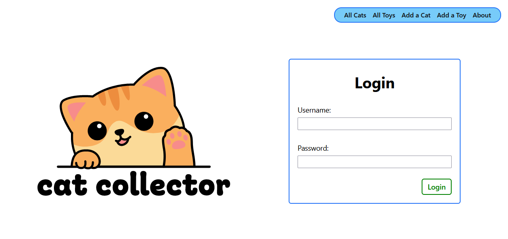
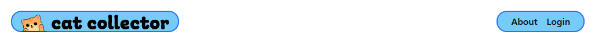
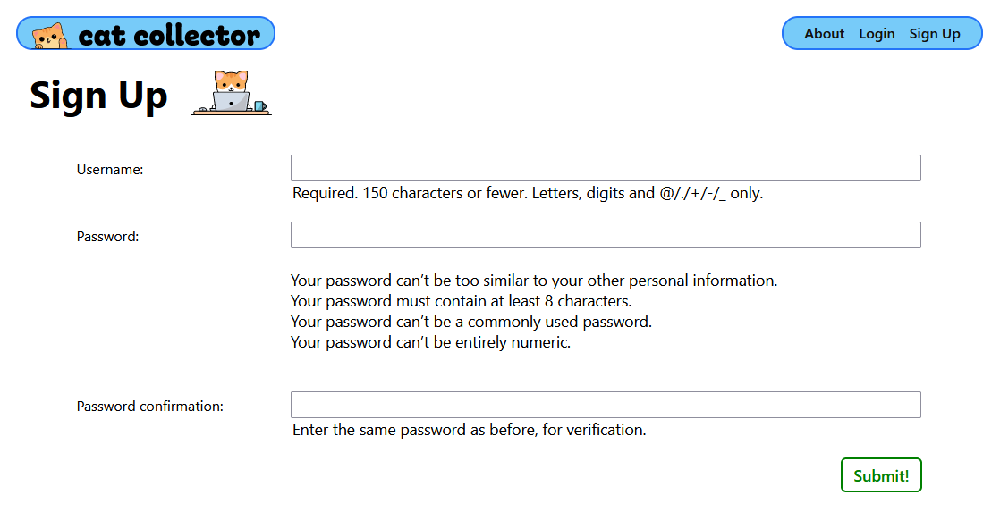

# 

**Learning objective:** By the end of this lesson, students will be able to tktk

# Set Up

This lesson’s picks up from the [Django Many-to-Many Relationships](../many-to-many-relationship/README.md)  lesson.

**Be sure to be inside of the catcollector directory** before you open VS Code with `code .`.

**Be sure that your virtual server is running!**

# Intro to Authentication in Django

By default, Django creates projects with authentication and authorization capabilities pre-installed!

Two review questions for you:

- **What is authentication?**
- **What is authorization?**

Django’s built-in authentication functionality is provided by the `'django.contrib.auth'` app included within the `INSTALLED_APPS` list in `settings.py`:

```python
INSTALLED_APPS = [
    'main_app',
    'django.contrib.admin',
    'django.contrib.auth',    # Thank You Django!
    'django.contrib.contenttypes',
    'django.contrib.sessions',
    'django.contrib.messages',
    'django.contrib.staticfiles',
]
```

Django provides the common **user** authentication where the user signs up and logs in with a **username** and **password**.

Django relies on server-side sessions, implemented by the `'django.contrib.sessions'` app, to track when a user is logged in or out.

## The `User` Model

At the core of Django’s authentication, is the provided `User` Model which by default has the following attributes:

- `username`
- `password`
- `email`
- `first_name`
- `last_name`

Although these attributes are fine for the Cat Collector, some projects may need additional attributes such as `birthdate`, `favorite_color`, etc. The **Level Up** section will point you in the right direction should you need this functionality.

# Creating the `User ---< Cat` Relationship

## Cat Collector’s Functionality is Changing

Currently, all furry critters in Cat Collector are wild - they don’t belong to a *Cat Collector* (the user).

The functionality of Cat Collector is about to change!

By the end of this lesson, with authentication implemented, all cats will belong to a user.

Ordinarily, it’s important to implement an app’s authentication up front to avoid having to make the changes to the code we’re going to have to make in Cat Collector.

## Update the `Cat` Model

Adding the relationship of ***A User has many Cats; and a Cat belongs to a User*** is much the same as with creating any other one-to-many relationship.

The `User` Model lives in the `django.contrib.auth` app, so the first thing we need to do is import it into `models.py`:

```python
from django.db import models
from django.urls import reverse
from datetime import date
# Import the User
from django.contrib.auth.models import User
```

One of the Models needs a *Foreign Key* - `User` or `Cat`…

<details>
<summary>Which one makes sense?</summary>

**Since the `Cat` Model belongs to another entity, it’s the one to hold the Foreign Key.**
</details>

Now let’s add the field linking a `Cat` to a `User`:

```python
class Cat(models.Model):
  ...
  toys = models.ManyToManyField(Toy)
  # Add the foreign key linking to a user instance
  user = models.ForeignKey(User, on_delete=models.CASCADE)
```

## Migrate the Change

Now that we’ve made a change to a Model that impacts the database, we need to migrate that change to the database.

However, there will now be a FK constraint on cats, which means that every cat record must hold the PK of a user record and because there are existing cats, Django is going to prompt us with two options…

In your terminal enter the following:

```bash
python3 manage.py makemigrations
```

Which then presents us with this message:

```
You are trying to add a non-nullable field 'user' to cat without a default;
we can't do that (the database needs something to populate existing rows).
Please select a fix:
 1) Provide a one-off default now (will be set on all existing rows with a null value for this column)
 2) Quit, and let me add a default in models.py
Select an option:
```

Option `1)` is our best option because it will allow us to enter the `id` of a user, which we created earlier this week (the superuser).

Go ahead and press `1` and `[enter]`, which will then prompt us to enter the value:

```
Please enter the default value now, as valid Python
The datetime and django.utils.timezone modules are available,
so you can do e.g. timezone.now
Type 'exit' to exit this prompt
>>>
```

Our superuser’s `id` should be `1`, so type `1` and press `[enter]`.

The migration file will then be created. Let’s migrate the changes. In your terminal enter the following:

```bash
python3 manage.py migrate
```

Congrats, the one-to-many relationship between User and Cat has been created and all existing cats have been collected by the superuser!

# Adding URLs for Authentication

Excluding login, we’re going to use Django’s built-in authentication features and default settings.

Django provides several class-based views that we can use for handling logging in and logging out.

However, before we can use those views, we’ll need URLs to map to them.

Lucky for us, the `django.contrib.auth` module contains predefined URLS that we can simply `include` like this in **`catcollector/urls.py`**:

```python
...
  path('admin/', admin.site.urls),
  path('', include('main_app.urls')),
  # include the built-in auth urls for the built-in views
  path('accounts/', include('django.contrib.auth.urls')),
]
```

We won’t need to import `django.contrib.auth.urls` because it’s just a string.

Including the built-in URLs has added the following URL patterns to the app:

```python
accounts/login/ [name='login']
accounts/logout/ [name='logout']
accounts/password_change/ [name='password_change']
accounts/password_change/done/ [name='password_change_done']
accounts/password_reset/ [name='password_reset']
accounts/password_reset/done/ [name='password_reset_done']
accounts/reset/<uidb64>/<token>/ [name='password_reset_confirm']
accounts/reset/done/ [name='password_reset_complete']
```

I know, it looks like there’s a lot there, but don’t worry, we get to pick and choose which ones to implement!

# Logging In

## Modifying the `home.html` Template

We're going to convert the existing `home` view function to a CBV that inherits from the `LoginView` class.

First import this class:

```python
from django.contrib.auth.views import LoginView
```

And make use of it in a class based view that ***replaces*** the current home view function.

```python
class Home(LoginView):
  template_name = 'home.html'
```

Don't forget to update `**urls.py**` to use the new CBV.

```python
path('', views.Home.as_view(), name='home'),
```

When `LoginView` renders the `**home.html**` template, it passes in the context a default `form` object we can display in `**home.html`.** Add it after the existing section:

```html
  />
</section>

<section>
  <form action="" method="post" class="login">
    <h1>Login</h1>
    
    {{ form.as_p }}
    <input type="hidden" name="next" value="{{ next }}">
    <button type="submit" class="btn submit">Login</button>
  </form>
</section>


```

The

```html
<input type="hidden" name="next" value="{{ next }}">
```

is really cool. It is a feature of Django’s authentication that will automatically redirect a user that tries to access a protected route back to that route after they log in!

Here's our new home page!

tktk - Hunter this is the image from the notion content


You can log in now, but you’ll get an error because by default, the login view redirects to `**/accounts/profile**`, but we can change this…

## Specifying the Default Redirect After Logging In

In Cat Collector, when a user logs in, we want them to see their cat *index* page.

The easiest way to make this happen is to add a new variable at the bottom of `settings.py`:

```python
STATIC_URL = 'static/'

# Add this variable to specify where successful logins should redirect to
LOGIN_REDIRECT_URL = 'cat-index'
```

The `django.contrib.auth` app uses that value of the `LOGIN_REDIRECT_URL` variable, if it exists, to redirect to after the user logs in.

Test it out - sweet!

# Updating the Nav Bar Dynamically

In most applications, many of the links displayed in a nav bar usually depend upon whether there is a logged in user or not.

In Cat Collector, if there’s no user logged in, all we want is to show the following links:

- About
- Sign Up
- Log In

Then, when there is a logged in user, we want to see:

- About
- Add a Toy
- View All Toys
- Add a Cat
- View All My Cats
- Log Out

Thanks again to the built-in auth, we automatically have a `user` variable available in every template!

To check if the user is logged in, we simply use `user.is_authenticated`, which returns `True` when logged in and `False` otherwise.

With this knowledge in hand, let’s make the nav bar dynamic in `**base.html**`:

```html
      <nav>
        <ul>
          
            <li><a href="">All Cats</a></li>
            <li><a href="">All Toys</a></li>
            <li><a href="">Add a Cat</a></li>
            <li><a href="">Add a Toy</a></li>
            <li><a href="">About</a></li>
            <li><a href="">Log out</a></li>
          
            <li><a href="">About</a></li>
            <li><a href="">Login</a></li>
          
        </ul>
      </nav>
```

Note how the **Log In** and **Log Out** links are using the `url` template tag along with the built-in named URL patterns (listed above).

However, we’re skipping the **Sign Up** link for now because Django does not include a default URL or view for signing up.

Now we should see the following nav if not logged in:

tktk - Hunter this is the image from the notion content


When you log in, you’ll see this nav:

tktk - Hunter this is the image from the notion content


Nice!

We also want to prevent the login form from being shown when there is a user logged in. A simple `if` template tag will accomplish this:

```html

  <section>
    <form action="" method="post" class="login">
      <h1>Login</h1>
      
      {{ form.as_p }}
      <input type="hidden" name="next" value="{{ next }}">
      <button type="submit" class="btn submit">Login</button>
    </form>
  </section>

```

Logging out even works, but it doesn’t redirect to our *Home* page (root route)…

# Logging Out

Thanks again to the `django.contrib.admin` app’s built-in `LogOut` view, we didn’t have to do a thing to implement logging out!

However, we’ll want to redirect to a URL different from the default which we can make happen in the same way we just did when logging in - by adding another variable to **`settings.py`**:

```python
STATIC_URL = 'static/'

LOGIN_REDIRECT_URL = 'cat-index'

# Add this variable to specify where logging out redirects to
LOGOUT_REDIRECT_URL = 'home'
```

That was easy!

# Update the `CatCreate` View to Assign a New Cat to the Logged in User

Since cats belong to a user, before a new cat can be added to the database, its user is going to have to be assigned to its `user` attribute that we added to the model earlier.

To do this, we’re going to have to add some additional code to the `CatCreate` view as follows:

```python
class CatCreate(CreateView):
  model = Cat
  fields = ['name', 'breed', 'description', 'age']
  
  # This inherited method is called when a
  # valid cat form is being submitted
  def form_valid(self, form):
    # Assign the logged in user (self.request.user)
    form.instance.user = self.request.user  # form.instance is the cat
    # Let the CreateView do its job as usual
    return super().form_valid(form)
```

We’re overriding the `CreateView`’s `form_valid` method to assign the logged in user, `self.request.user`. Yes, the built-in auth automatically assigns the user to the `request` object similar to what Passport did in Express.

In Python, methods inherited by the superclass can be invoked by prefacing the method name with `super()`. Accordingly, after updating the form to include the user, we’re calling `super().form_valid(form)` to let the `CreateView` do its usual job of creating the model in the database and redirecting.

Okay, let’s check out the refactor by:

- First, opening the admin app: http://localhost:3000/admin
- Click on **Cats**
- Select a cat and verify the user is assigned to it
- Leave the admin app open, and go add a new cat in Cat Collector
- Back in the admin app, go to all cats then click on the one just added and verify that the user’s been assigned!

Moving right along…

# Sign Up New Users

Unfortunately, Django’s built-in auth does not provide a URL or view for signing up new users.

## Add a URL

First we’ll add the last URL pattern to this application, which will implement the sign up functionality in `**main_app/urls.py**`:

```python
path('cats/<int:cat_id>/assoc-toy/<int:toy_id>/', views.assoc_toy, name='assoc-toy'),

# New url pattern below
path('accounts/signup/', views.signup, name='signup'),
```

To stay consistent with Django’s auth-related URLs, we’ll preface the pattern with `accounts/`.

There’s no generic view available to help us out, so we’re going to write the new view function named `signup` that the server is waiting for.

## Add the `signup` View Function

The `signup` view function will be the first view we’ve coded that performs two different behaviors based upon whether it was called via a GET or POST request:

- If it’s a **GET request**: The view function should render a template with a form for the user to enter their info.
- If it’s a **POST request**: The user has submitted their info and the function should create the user and redirect.

Although Django did not include a URL or view, it **does** include a `UserCreationForm` that we can use in a template to generate all of the inputs for a `User` model.

In addition, we’re also going to use the `login` function to automatically log in a user when they sign up - users hate signing up and then having to turn around and log in!

Let’s import them near the top of **`views.py`**:

```python
...
from django.views.generic import ListView, DetailView
# Add the two imports below
from django.contrib.auth import login
from django.contrib.auth.forms import UserCreationForm
...
```

Now let’s code the `signup` view function - we’ll review as we type it in:

```python
def signup(request):
  error_message = ''
  if request.method == 'POST':
    # This is how to create a 'user' form object
    # that includes the data from the browser
    form = UserCreationForm(request.POST)
    if form.is_valid():
      # This will add the user to the database
      user = form.save()
      # This is how we log a user in
      login(request, user)
      return redirect('cat-index')
    else:
      error_message = 'Invalid sign up - try again'
  # A bad POST or a GET request, so render signup.html with an empty form
  form = UserCreationForm()
  context = {'form': form, 'error_message': error_message}
  return render(request, 'signup.html', context)
  # Same as: return render(request, 'signup.html', {'form': form, 'error_message': error_message})
```

There’s really no way to remember that code, so just refer to this lesson, the docs, or Google.

## Add the **Sign Up** Link to the Nav

Now that we know the URL, we can add a **Sign Up** link to the nav in `**base.html**`:

```html
          
            <li><a href="">About</a></li>
            <li><a href="">Login</a></li>
            <li><a href="">Sign Up</a></li>
          
```

## Create the **`signup.html`** Template

Run the following in the terminal:

```bash
touch main_app/templates/signup.html
```

Here's the code for `**signup.html**`:

```html




<link rel="stylesheet" type="text/css" href=""/>




<div class="page-header">
  <h1>Sign Up</h1>
  
</div>

  <p class="red-text">{{ error_message }}</p>

<form action="" method="post" class="form-container" autocomplete="off">
  
  <table>
    {{ form.as_table }}
  </table>
  <button type="submit" class="btn submit">Submit!</button>
</form>


```

With the above template, clicking the Sign Up in the nav should show a page like the following:

tktk - Hunter this is the image from the notion content


By using the the `UserCreationForm`, you get help messages that go with all of the validations.

However, notice that the form does not include inputs for the user’s:

- `email`
- `first_name`
- `last_name`

To include these, you’ll have to create your own `ModelForm` based upon the `User` Model.

If you want to remove some of the password validations, you can comment them out or remove them from the `AUTH_PASSWORD_VALIDATORS` list in `**settings.py**`.

You should now be able to sign up!

# Displaying Only the User’s Cats

If you sign up or log in with a different user, you’ll notice that all of the cats in the database are still showing up on the *index* page.

If we take a look at the `cat_index` view, we’ll see why:

```python
def cat_index(request):
  # This reads ALL cats, not just the logged in user's cats
  cats = Cat.objects.all()
  return render(request, 'cats/index.html', { 'cats': cats })
```

To display just the logged in user’s cats, we just need to change the query to this:

```python
def cat_index(request):
  cats = Cat.objects.filter(user=request.user)
  # You could also retrieve the logged in user's cats like this
  # cats = request.user.cat_set.all()
  return render(request, 'cats/index.html', { 'cats': cats })
```

Last step, coming up!

# Implement Authorization

Now that authentication has been implemented, the last step is to protect the routes that are dependent upon a user being logged in.

Yes, the dynamic nav bar helps prevent access, but users can still type something like http://localhost:3000/cats in the address bar when nobody is logged in, which will raise an error.

Of course Django provides an easy way to protect both function and class-based views…

## Implement Authorization on View Functions

To protect view functions, we use the `login_required` decorator.

First we need to import it near the top of `**views.py**`:

```python
...
from django.contrib.auth.forms import UserCreationForm
# Import the login_required decorator
from django.contrib.auth.decorators import login_required
```

Now we can simply “decorate” any view function that requires a user to be logged in like this:

```python
@login_required
def cat_index(request):
  ...
```

Trying to browse to http://localhost:3000/cats while not logged in will now send you to the Log In page!

This doesn't quite work yet though - we need to tell Django where we want these decorators and mixins to actually redirect to. We just need to add a `LOGIN_URL` to our `settings.py` file and have it redirect to the `'home'` URL:

```python
STATIC_URL = '/static/'

# Add this variable to specify where decorators and mixins should redirect to
LOGIN_URL = 'home'

LOGIN_REDIRECT_URL = 'cat-index'

LOGOUT_REDIRECT_URL = 'home'
```

Be sure to add the `@login_required` to these remaining view functions:

- `cat_detail`
- `add_feeding`
- `assoc_toy`

## Implement Authorization on Class-based Views

Protecting class-based views is slightly different, it uses what’s called a mixin, which is another class to inherit from - in OOP, we call this *multiple inheritance*.

As usual, we’ll need to import it:

```python
...
from django.contrib.auth.decorators import login_required
# Import the mixin for class-based views
from django.contrib.auth.mixins import LoginRequiredMixin
```

Finally, we can protect class-based views like this:

```python
class CatCreate(LoginRequiredMixin, CreateView):
  ...
```

Not all OOP languages support the concept of multiple inheritance, but Python does.

Be sure to add `LoginRequiredMixin` to these remaining classes:

- `CatUpdate`
- `CatDelete`
- `ToyList`
- `ToyDetail`
- `ToyCreate`
- `ToyUpdate`
- `ToyDelete`

## Wrap up Authorization

Wow, that was a blast - congrats!

# Summary

Authentication is incredibly important to virtually every application.

Most features of an application are dependent upon knowing which user is accessing the feature.

This is why it’s **so important** to implement authentication in your projects up front, immediately after the user story for when first browsing as an anonymous user to the root route:
*As a Visitor, upon browsing to the application I want [insert feature here]*
