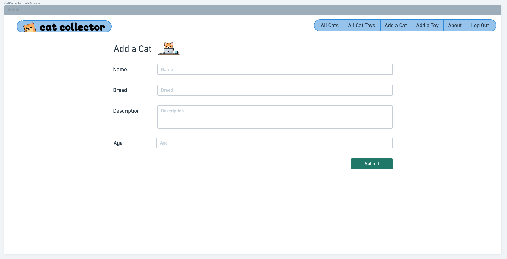
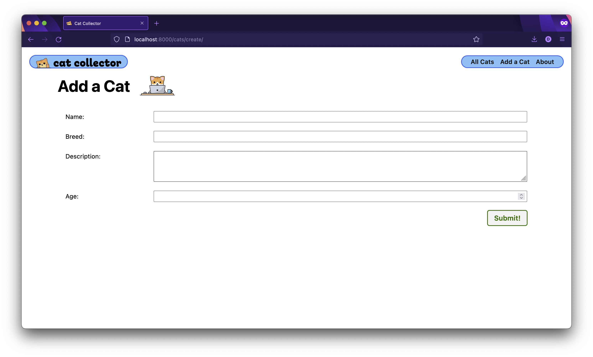
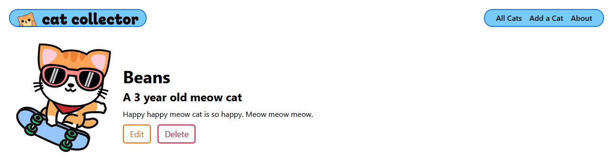
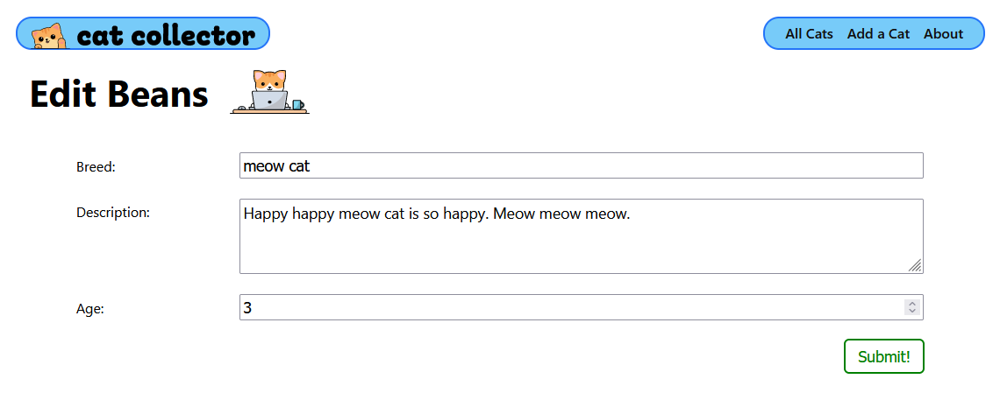
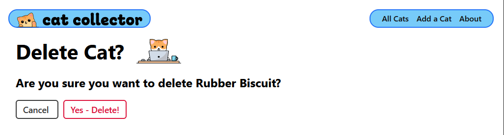

# 

**Learning objective:** By the end of this lesson, students will be able to tktk

# Adjust the nav

This lesson continues to build-out Cat Collector beginning from where the [Cat Collector - Part 2 - Django Models](https://www.notion.so/Cat-Collector-Part-2-Django-Models-138d197c4b784fa891295b2f8789bde3?pvs=21) lesson left off.

Let's adjust the nav in `**base.html**` to use the `url` template tag instead of hard-coding the URL in the links:

```html
<!-- <li><a href="/cats">All Cats</a></li>  BYYYYYE -->
<li><a href="">All Cats</a></li>
<!-- <li><a href="/about">About</a></li>  BYYYYE-->
<li><a href="">About</a></li>
```

> ❓ What enables us to use the `url` template tag to automatically generate the proper URL?

# What are Class-based Views?

> ❓ First, what’s a Django View?

Class-based Views are classes defined in the Django framework that we can extend and use instead of *view functions*. For example, let’s say we wanted to implement the *index* (view all) functionality for a Books data resource:

```python
from django.views.generic import ListView

class BookList(ListView):
    model = Book
```

`ListView` is a built-in generic CBV designed to implement the “index” (list) functionality for a particular Model.

We extended the generic `ListView` to create a `BookList` and used

```python
    model = Book
```

to inform `BookList` that it is to access the `Book` Model.

Then, in `**urls.py**`, we invoke the `as_view()` class method of the `BookList` CBV (which returns a view function) and connect it to a route as usual:

```python
from django.urls import path
from books.views import BookList

urlpatterns = [
  path('books/', BookList.as_view(), name='book-index'),
]
```

Notice that there’s not even a call to render? By default, the CBV will expect to render a template named `**templates/<name of app>/book_list.html**`. This convention can be overridden.

In addition to the `ListView` used to display the index page for a Model, there are also:

- `DetailView` - used to implement the “detail” page for an instance of a Model
- `CreateView` - used to create an instance of a Model
- `DeleteView` - used to delete an instance of a Model
- `UpdateView` - used to update an instance of a Model

In this lesson, we will be extending the `CreateView`, `UpdateView` and `DeleteView` CBVs to CUD cats!

We also could easily replace the existing `cat_index` and `cat_detail` view functions with CBVs, however, we won’t so that you have a reminder of how they are structured.

# Why use Class-based Views?

Django **[has this to say](https://docs.djangoproject.com/en/4.2/topics/class-based-views/intro/#the-relationship-and-history-of-generic-views-class-based-views-and-class-based-generic-views)** about why they created Class-based Views. Much of the code we write in CRUD applications repeats certain patterns again and again. As you saw in the above example, we can leverage CBVs to avoid having to write the same repeating code over and over.

CBVs can save time, thus making us more productive developers. CBVs are highly configurable by adding class attributes, overriding methods and using decorators (see the Level Up).

For example, we set the `template_name` attribute to render a template other than the default:

```python
class BookList(ListView):
  model = Book
  template_name = 'books/index.html'
```

# Creating Data Using a CBV

We need a way to create cats in Cat Collector!

## Add the Route

If this was an Express app, we would need to code two separate routes and controller actions like:

- `router.get('/cats/new', catsCtrl.new);` to view the form, and
- `router.post('/cats', catsCtrl.create);` to add the cat to the database and then redirect

However, using Django, we only need a single URL-based route because a `CreateView` CBV will automatically:

- Create a Django ModelForm used to automatically create the form’s inputs for the Model.
- If the request is a `GET`, render a template (where we’ll include a `<form>`) and
- In the case of a `POST`, use the posted form’s contents to automatically and transparently create data and perform a redirect.

Let’s add the new URL pattern to `**main_app/urls.py**`

```python
urlpatterns = [
  path('', views.home, name='home'),
  path('about/', views.about, name='about'),
  path('cats/', views.cat_index, name='cat-index'),
  path('cats/<int:cat_id>/', views.cat_detail, name='cat-detail'),
  # new route used to show a form and create a cat
  path('cats/create/', views.CatCreate.as_view(), name='cat-create'),
]
```

The `path()` function still needs a view **function** as its second argument, not a class, and that’s what a CBV’s `as_view()` method returns.

> 💡 Did you notice that we didn’t have to put that route above the `cats/<int:cat_id>/`? Unlike Express, Django won’t match that route unless there’s something that looks like an integer in the second segment, thus it ignores cats/create/

We’ll need to add the `views.CatCreate` CBV to make the server happy, but first let’s add a link to the nav for adding a cat…

## Update the UI

Now that we know the path that’s used to **BOTH**:

- View a form for entering cat info; and
- Creating the cat when the form is submitted

let’s update `base.html` to add a link to the nav:

```html
        <ul>
          <li><a href="">All Cats</a></li>
           New link below 
          <li><a href="">Add a Cat</a></li>
          <li><a href="">About</a></li>
        </ul>
```

On to the view!

## Extending the Generic `CreateView`

First, to use any Class view in Django, it needs to be imported:

```python
from django.shortcuts import render
# Add the following import
from django.views.generic.edit import CreateView
from .models import Cat
```

Now we can inherit from `CreateView` to create our own CBV used to create cats:

```python
class CatCreate(CreateView):
  model = Cat
  fields = '__all__'
```

The `fields` attribute is required and can be used to limit or change the ordering of the attributes from the `Cat` model are generated in the `ModelForm` passed to the template.

We’ve taken advantage of the special `'__all__'` value to specify that the form should contain all of the `Cat` Model’s attributes. Alternatively, we could have listed the fields in a list like this:

```python
class CatCreate(CreateView):
  model = Cat
  fields = ['name', 'breed', 'description', 'age']
```

That’s all of the code we need to write to display a template with the form that’s automatically passed to it and create a Cat when form is submitted (the request is a `POST` instead of a `GET`).

> It won’t always be quite this easy as we’ll see in the future when we need to add some additional class attributes or override methods in the CBV.

On to the template!

## Create the Template for Creating Cats

Here's our wireframe:

tktk - Hunter this is the image from the notion content


By convention, the `CatCreate` CBV will look to render a template named `**templates/main_app/cat_form.html**`.

All CBVs by default will use a folder inside of the `**templates**` folder with a name the same as the app, in our case `main_app`.

Let’s give `CatCreate` the template it wants by first creating the `**templates/main_app**` folder in the terminal:

```bash
mkdir main_app/templates/main_app
```

Now create the template file in the terminal:

```bash
touch main_app/templates/main_app/cat_form.html
```

Note that the `CreateView` renders a default template named as follows: `**<name of model>_form.html**` (lowercased, of course). The docs tell us to do this **[here](https://docs.djangoproject.com/en/4.2/topics/class-based-views/generic-editing/#model-forms)** if we scroll down a bit to the last note in this section.

There’s not too much so we’ll review as we type it in:

```html




<link rel="stylesheet" type="text/css" href=""/>




<div class="page-header">
  <h1>Add a Cat</h1>
  
</div>
 
  Leaving the action empty makes the form post to the same url used to display it

<form action="" method="post" class="form-container">
   
    Django requires the following for security purposes
  
  
  <table>
    
      Render the inputs inside of <tr>s & <td>s
    
    {{ form.as_table }}
  </table>
  <button type="submit" class="btn submit">Submit!</button>
</form>


```

The `` template tag is a security measure that makes it difficult to perform a [**cross-site-request-forgery**](https://en.wikipedia.org/wiki/Cross-site_request_forgery) by writing a CSRF (pronounced “see-surf”) token that is validated on the server.

The `form` variable is an instance of the `ModelForm` class instantiated automatically by the `CreateView` and passed to the template (via the context dictionary). We’ll learn more about `ModelForm`s in a later lesson.

A new page means new CSS! We’ll be using this same form CSS throughout this app, so we’re just going to put it in the main `**css**` directory for this application. Run the following command in the terminal:

```bash
touch main_app/static/css/form.css
```

And here's the CSS:

```css
.form-container {
  display: flex;
  flex-direction: column;
  width: 100%;
}

table {
  padding: 0 40px;
  width: 100%;
  border-spacing: 0 20px;
}

th {
  text-align: left;
  padding: 6px 20px 0 0;
  font-weight: normal;
  vertical-align: top;
  font-size: var(--font-reg);
}

td {
  max-width: 60%;
}

td > * {
  width: 100%;
  padding: 2px 4px;
  font-size: var(--font-l);
}

td > textarea {
  height: calc(4 * var(--font-l) + 8px);
  font-family: inherit;
}

.btn {
  align-self: flex-end;
  margin-right: 40px;
}
```

Let’s refresh and click the **Add a Cat** link.

Not too bad:

tktk - Hunter this is the image from the notion content


Use Devtools to explore the DOM. You’ll see how Django’s ModelForm wrote the inputs in table rows and columns because we used `{{ form.as_table }}`. Other options include:

- `{{ form }}` - No wrapper around the `<label>` & `<input>` tags
- `{{ form.as_p }}` - Wraps a `<p>` tag around the `<label>` & `<input>` tags
- `{{ form.as_ul }}` - Wraps an `<li>` tag around the `<label>` & `<input>` tags

> Note: To ease custom styling, you can add an id or class to your`<table>` and/or `<form>` tags. Also note how Django automatically assigns an id to each input.

## Redirecting

If we submit the form to create a cat, the cat will be created, however, we’ll receive an error because Django doesn’t know where we want our app to redirect to.

One way to fix this is by adding a `success_url` class attribute to the CBV like this:

```python
class CatCreate(CreateView):
  model = Cat
  fields = '__all__'
  success_url = '/cats/'
```

However, we would need to write a method if we wanted to redirect to the cat that was just created which would be a bit of work. For better code reuse, Django recommends adding a `get_absolute_url` method to the **Model** instead.

Let’s take Django’s advice by updating the `Cat` model:

```python
class Cat(models.Model):
  name = models.CharField(max_length=100)
  breed = models.CharField(max_length=100)
  description = models.TextField(max_length=250)
  age = models.IntegerField()

  def __str__(self):
    return self.name
    
  # Add this class method
  def get_absolute_url(self):
    return reverse('cat-detail', kwargs={'cat_id': self.id})
```

The **[reverse](https://docs.djangoproject.com/en/4.2/ref/urlresolvers/#reverse)** above will return the correct path for the `cat-detail` named route. However, since that route requires a `cat_id` route parameter, its value must provided as a shown above.

Let’s not forget to import `reverse` in `**models.py**`:

```python
from django.db import models
# Import the reverse function
from django.urls import reverse
```

We’ve covered all of the fundamentals of class-based views above so we’ll be a little more brief while adding the functionality to delete and update cats by combining their steps together…

# Updating & Deleting Data Using a CBV

Here are the user stories we want to implement:

- *AAU, when viewing a cat’s detail page, I want to click EDIT to update that cat’s information.*
- *AAU, when viewing a cat’s detail page, I want to click DELETE to remove that cat from the database.*

## Add the Routes

Let’s add the two new routes in `urls.py`:

```python
  path('cats/create/', views.CatCreate.as_view(), name='cat-create'),
  # Add the new routes below
  path('cats/<int:pk>/update/', views.CatUpdate.as_view(), name='cat-update'),
  path('cats/<int:pk>/delete/', views.CatDelete.as_view(), name='cat-delete'),
```

> 🚨 By convention, CBVs that work with individual model instances will expect to find a named parameter of `pk`. This is why we didn’t use `cat_id` as we did in the *detail* entry.

## Update the UI

We need to see EDIT and DELETE links on a cat’s detail page.

Let’s update `**templates/cats/detail.html**` by adding to a cat’s details a `<div>` with class of `cat-actions`:

```html
    <p>{{ cat.description }}</p>
     New markup 
    <div class="cat-actions">
      <a href="" class="btn warn">Edit</a>
      <a href="" class="btn danger">Delete</a>
    </div>
     New markup above 
  </div>
</section>
```

Now for the views…

## Subclass the `UpdateView` & `DeleteView`

We’ve referenced the new `CatUpdate` and `CatDelete` views in the routes so we need to add them to `views.py`.

But first we’ll need to import the two additional generic CBVs to extend from:

```python
# Add UdpateView & DeleteView
from django.views.generic.edit import CreateView, UpdateView, DeleteView
```

Now for the amazingly minimal new code:

```python
class CatUpdate(UpdateView):
  model = Cat
  # Let's disallow the renaming of a cat by excluding the name field!
  fields = ['breed', 'description', 'age']

class CatDelete(DeleteView):
  model = Cat
  success_url = '/cats/'
```

Note that if we delete a cat, we’ll need to redirect to the cats *index* page since that cat doesn’t exist anymore.

Now the server should be back up and clicking on a cat should result in a page that looks something like this:

tktk - Hunter this is the image from the notion content


That is all it takes - updating a cat is working, however, we’ll need to add an extra template to implement delete functionality, which we’ll do in a moment.

First though, to enhance the UX, it would be nice to see the name of the cat we’re editing instead of the header that we're adding a cat…

## Customize the `cat_form.html` Template

Since we didn’t include `'name'` in the fields list in `CatUpdate`, the `name` attribute isn’t listed in the form.

We’re going to customize `**cat_form.html**` to show the cat’s name that is being edited, and learn a little more about Django in the process.

The CBVs that work with a single model instance automatically pass as part of the context two attributes that are assigned the model instance. The attributes are named `object` and, in this case, `cat` (the lowercase name of the Model).

`object` or `cat` will be set to `None` in a `CreateView`, which makes sense.

> 💡 FYI, in a ListView, the queryset of model instances will be available via attributes named object_list and cat_list (again, the lowercase name of the Model with _list appended to it).

Let’s leverage this new knowledge to modify `**templates/main_app/cat_form.html**` to show the cat’s name only when we are editing, not creating, a cat:

```html

  <!-- New if/else block -->
  
    <h1>Edit {{ cat.name }}</h1>
  
    <h1>Add a Cat</h1>
  
```

We could also do:

```html
  
    <h1>Edit {{object.name}}</h1>
  
    <h1>Add a Cat</h1>
  
```

These two blocks are functionally equivalent and we could use either.

Looking good:



Okay, let’s get delete functionality working then we’re done!

## Adding a `**cat_confirm_delete.html**` Template

It’s usually wise to perform some type of confirmation when deleting data and Django makes it easy when we subclass a `DeleteView` by automatically rendering a confirmation template.

All we have to do is create it named as follows as specified **[here](https://docs.djangoproject.com/en/4.2/topics/class-based-views/generic-editing/#model-forms)**. Run the following in the terminal:

```bash
touch main_app/templates/main_app/cat_confirm_delete.html
```

Now for its content:

```html





<div class="page-header">
  <h1>Delete Cat?</h1>
  
</div>
<h2>Are you sure you want to delete {{ cat.name }}?</h2>

<form action="" method="post" class="form">
  
  <a 
    href="" 
    class="btn secondary"
  >
    Cancel
  </a>
  <button type="submit" class="btn danger">Yes - Delete!</button>
</form>


```

Note how we are allowing the user to cancel the delete by providing a link back to the *detail* page.

Let’s check it out by refreshing:



Congrats for implementing full CRUD for cats!

In the next lesson we’ll see how to work with One-Many data relationships.

As usual, your lab is to implement the same class-based views in you Finch Collector project.

# Review Questions ❓

<details>
<summary>To be more productive, Class-based Views can be used in lieu of ______ __________.</summary>

View Functions
</details>

<details>
<summary>What generic class do we extend to create our own CBV for creating model instances?</summary>

`CreateView`
</details>

<details>
<summary>What class attribute must we provide to every CBV to inform the CBV what Model its for?</summary>
    
`model`
</details> 
    
<details>
<summary>True or False: A `CreateView` performs different behavior depending upon the HTTP request being a `GET` or a `POST`?</summary>

True
</details>
