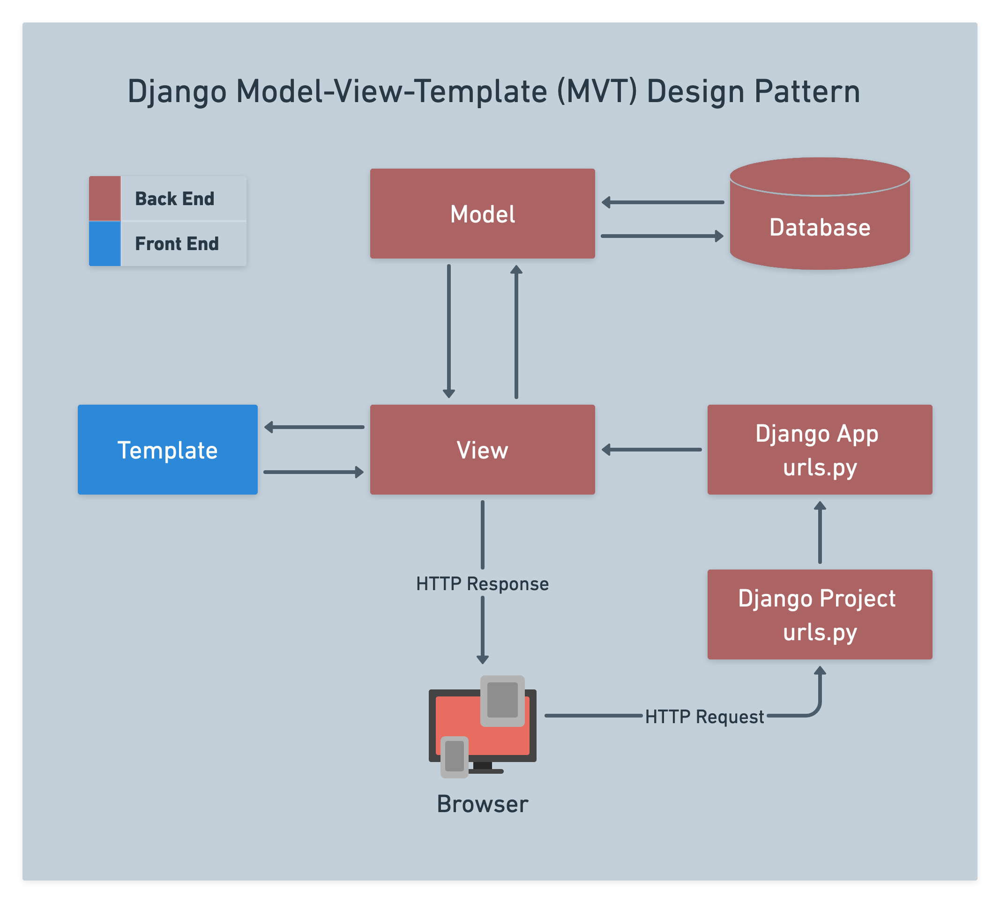

# 

**Learning objective:** By the end of this lesson, students will be able to tktk

# Minimalist vs. Full-featured Frameworks

## Review The Philosophy of Express

Express was a minimalist framework that didn’t provide much functionality out of the box.

It gave us a way to define routes, map controller actions to those routes, and render dynamic views.

Express didn’t have many rules, for example, we could name files anything and put them anywhere we wanted.

If we did need additional capability, it usually meant installing and configuring additional middleware.

## The Philosophy of Django

Unlike Express, Django, is a full-featured web framework that provides a lot of built-in functionality.

Django has many *conventions*, and it expects us to follow its rules.

You will find that Django has all sorts of *helper* classes, methods, etc.

What Express has to offer can be grasped in a matter of days, whereas Django could take months to feel comfortable with what it has to offer.

Luckily for us, the basics of Django aren’t too bad, as long as you keep it simple.

# The Request/Response Cycle in Django

In Unit 2, we learned that in a full-stack web application:

- Clicking links and submitting forms on the front-end (browser) sends HTTP requests to the web app running on a web server.
- The web server has a routing mechanism that matches HTTP requests to code.
- That code typically performs CRUD, then either:
    - Renders dynamic templates for Read data operations.
    - Redirects the browser in the case of Create, Update or Delete data operations.

Once again, let’s review this diagram that shows how a request flows through a Django project:

tktk - Hunter this is the image from the notion content

