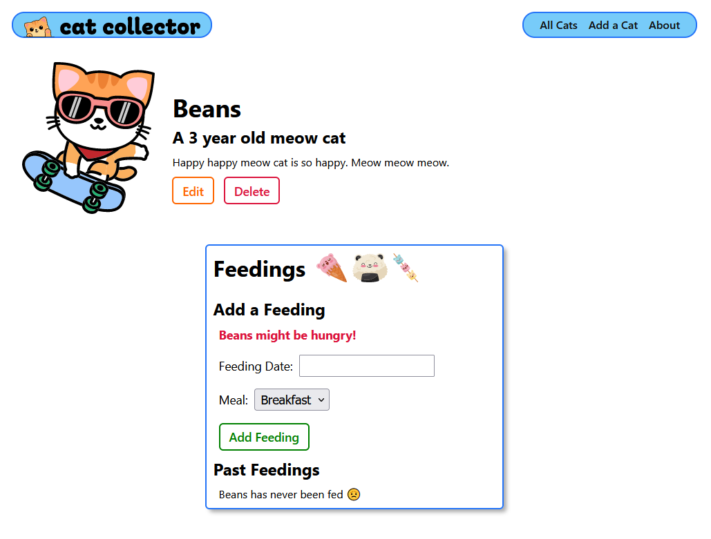
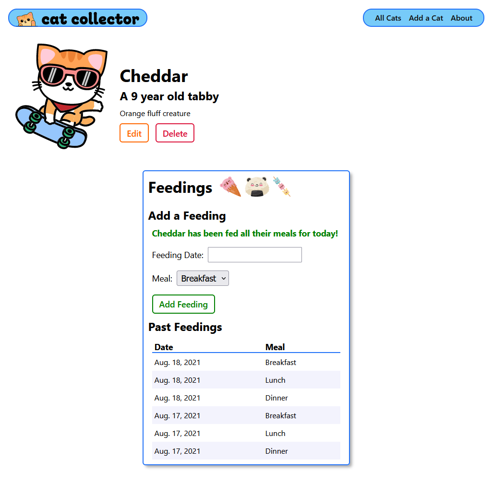
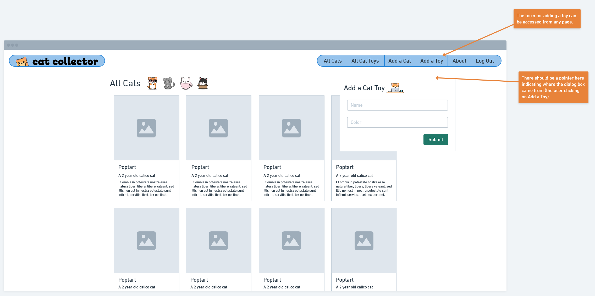
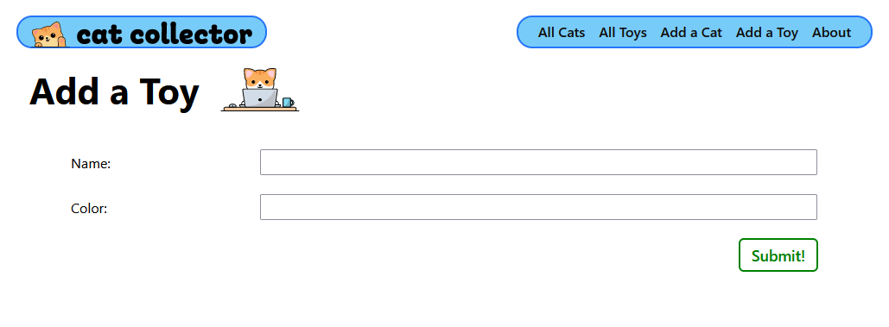
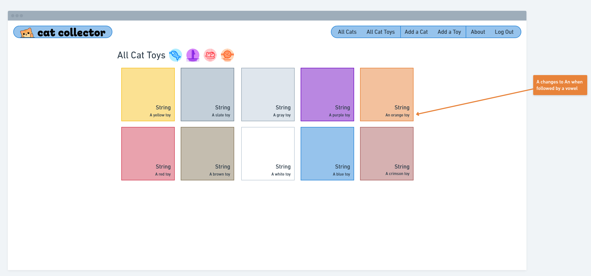
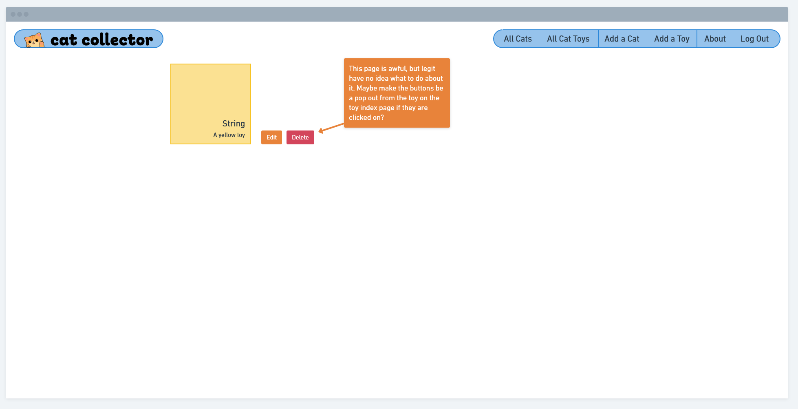
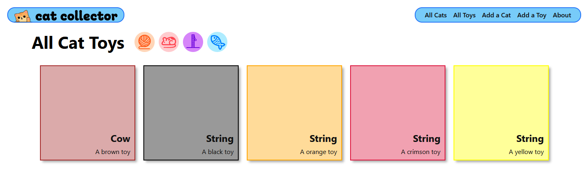
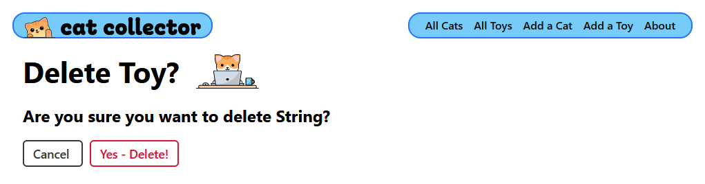

# 

**Learning objective:** By the end of this lesson, students will be able to tktk

# Getting Started

We’re going to pick up from where we left off in [Django One-to-Many Models & ModelForms](../one-to-many-relationship/) . We're going to start by adding a bit of detail to our cat feedings showing a message if a cat has been fed that day or not. We'll also add a `Toy` model and associated CBV’s/URLs. Finally we'll make a small adjustment to the Cat model, as well as the cat detail HTML.

# Adding a Custom Method to Check the Feeding Status

When adding *business logic* to an application, always consider adding that logic to the Models first.

This approach is referred to as “fat models / skinny views” and results in keeping code DRY.

We’re going to add a custom method to the `Cat` Model that help’s enable the following messaging based upon whether or not the cat has had at least the number of feedings for the current day as there are `MEALS`.

When a cat does not have at least the number of `MEALS`:

tktk - Hunter this is the image from the notion content


And when the cat has been completely fed for the day:

tktk - Hunter this is the image from the notion content


## The `fed_for_today` Custom Model Method

Let’s add a one line method to the `Cat` Model class:

```python
from django.db import models
from django.urls import reverse
# add this import
from datetime import date

class Cat(models.Model):
  ...
  # add this new method
  def fed_for_today(self):
    return self.feeding_set.filter(date=date.today()).count() >= len(MEALS)
```

Be sure to add the import at the top of `**models.py**`.

The `fed_for_today` method demonstrates the use of `filter()` to obtain a `<QuerySet>` for today’s feedings, then `count()` is chained on to the query to return the actual number of objects returned.

The above approach is more efficient than this similar code:

```python
len( self.feeding_set.filter(date=date.today()) )
```

because this code would return all objects from the database when all we need is the number of objects returned by `count()`. In other words, don’t return data from the database if you don’t need it.

## Update the **`detail.html`** Template

All that’s left is to sprinkle in a little template code like this:

```html
    <form
      action="" 
      method="post" 
      class="subsection-content"
    >
       New markup below 
      
        <p class="fed">{{cat.name}} has been fed all their meals for today!</p>
      
        <p class="unfed">{{cat.name}} might be hungry!</p>
      
       New markup above 
      
      {{ feeding_form.as_p }}
      <button type="submit" class="btn submit">Add Feeding</button>
    </form>
```

Congrats on using a custom Model method to implement business logic!

# Toy model

Start by adding the `Toy` model to our project. This model has a name and a color field, along with 

```python
# Add the Toy model
class Toy(models.Model):
  name = models.CharField(max_length=50)
  color = models.CharField(max_length=20)

  def __str__(self):
    return self.name

  def get_absolute_url(self):
    return reverse('toy-detail', kwargs={'pk': self.id})
```

A new model means new entry in `**admin.py**`. Here it is!

```python
from django.contrib import admin

from .models import Cat, Feeding, Toy

admin.site.register(Cat)
admin.site.register(Feeding)
#Add the Toy model
admin.site.register(Toy)
```

A new model also means we need to make migrations and migrate in our terminal:

```bash
python3 manage.py makemigrations
python3 manage.py migrate
```

# Adding Toys

Here's our wireframe for adding toys - the concept here was to have the Add a Toy form available on every page, but we're just going to create a CBV for it. Try tackling this functionality on your own as a **Level Up 🚀.**

tktk - Hunter this is the image from the notion content


Start by adding the URL we want to create in `**main_app/urls.py**`.

```python
  path('toys/create/', views.ToyCreate.as_view(), name='toy-create'),
```

Update the `**base.html**` with the new link so that we can get to the template we're going to build.

```html
        <ul>
          <li><a href="">All Cats</a></li>
          <li><a href="">Add a Cat</a></li>
           Add this link! 
          <li><a href="">Add a Toy</a></li>
          <li><a href="">About</a></li>
        </ul>
```

Add the Class Based View to create for the `Toy` model. Make sure you import the Toy model!

```python
from .models import Cat, Toy

class ToyCreate(CreateView):
  model = Toy
  fields = '__all__'
```

And finally create and write the template!  Run the following in the terminal:

```bash
touch main_app/templates/main_app/toy_form.html
```

We're going to go ahead and set this form up for edit as well, so we don't need to return to it later.

```html




<link rel="stylesheet" type="text/css" href=""/>



<div class="page-header">
  
    <h1>Edit {{object.name}}</h1>
  
    <h1>Add a Toy</h1>
  
  
</div>
<form action="" method="post" class="form-container" autocomplete="off">
  
  <table>
    {{ form.as_table }}
  </table>
  <button type="submit" class="btn submit">Submit!</button>
</form>


```

Test it out! We should be able to create toys now, except we don't have anywhere to view them and we get an error when we submit the form. Let's change that by adding a way to view all the cat toys and a single cat toy.

tktk - Hunter this is the image from the notion content


# Viewing Toys

Here's a couple of wireframes, one for an Index page, one for a show page:

tktk - Hunter this is the image from the notion content



There's a couple extra ideas presented in the wireframes for you to use as **Level Up 🚀 c**ontent.

Start with the 2 URLs we're going to use:

```python
  path('toys/<int:pk>/', views.ToyDetail.as_view(), name='toy-detail'),
  path('toys/', views.ToyList.as_view(), name='toy-index'),
```

Then add a link in the nav bar to view all the toys.

```html
        <ul>
          <li><a href="">All Cats</a></li>
           Add this link! 
          <li><a href="">All Toys</a></li>
          <li><a href="">Add a Cat</a></li>
          <li><a href="">Add a Toy</a></li>
          <li><a href="">About</a></li>
        </ul>
```

Our nav bar is done until we get to [Authentication](../authentication/README.md) - and it looks great! Time to write the views.

```python
from django.views.generic import ListView, DetailView

class ToyList(ListView):
  model = Toy

class ToyDetail(DetailView):
  model = Toy
```

These views need to take us somewhere! Let's create those files, then we'll fill them with content. Run the following in the terminal:

```bash
touch main_app/templates/main_app/toy_list.html main_app/templates/main_app/toy_detail.html
```

## All Toys

Here's our **`main_app/toy_list.html`** template.

```html
 
 


<link
  rel="stylesheet"
  type="text/css"
  href=""
/>




<section class="page-header">
  <h1>All Cat Toys</h1>
  
  
  
  
</section>

<section class="card-container">
  
  <div class="card" style="border-color: {{ toy.color }}">
    <div class="card-bg" style="background-color: {{ toy.color }}"></div>
    <a href="">
      <div class="card-content">
        <h2>{{ toy.name }}</h2>
        <p>A {{ toy.color }} toy</p>
      </div>
    </a>
  </div>
  
</section>


```

We'll need a new CSS file for this page too. Again, we're just going to create the toy detail CSS file while we're at it.  Run the following in the terminal:

```bash
mkdir main_app/static/css/toys
```

```bash
touch main_app/static/css/toys/toy-index.css main_app/static/css/toys/toy-detail.css
```

And here's the CSS for this page:

```css
.card-container {
  padding: 0 40px;
  display: flex;
  justify-content: center;
  flex-wrap: wrap;
}

.card {
  width: 224px;
  height: 224px;
  margin: 10px;
  border: solid 2px;
  box-shadow: var(--card-box-shadow);
  position: relative;
}

.card-bg{
  opacity: .4;
  position: absolute;
  display: inline-flex;
  top: 0;
  left: 0;
  width: 100%;
  height: 100%;
}

.card-content {
  padding: 15px;
  height: 100%;
  width: 100%;
  display: flex;
  align-items: flex-end;
  justify-content: flex-end;
  flex-direction: column;
}

.card > a {
  position: absolute;
  top: 0;
  left: 0;
  width: 100%;
  height: 100%;
  display: inline-block;
  text-decoration: none;
  color: var(--text-color);
}

.card h2 {
  margin: 7px 0;
  font-size: var(--font-xl);
}

.card p {
  margin: 0;
  font-size: var(--font-reg);
}

.page-header > img {
  margin-left: 10px;
}

.page-header > img:first-of-type {
  margin-left: 15px;
}
```

And finally we can see our result!

tktk - Hunter this is the image from the notion content


## One Toy

Here's the template for the toy detail page:

```html
 
 


<link
  rel="stylesheet"
  type="text/css"
  href=""
/>



  
<div class="card" style="border-color: {{ toy.color }}">
  <div class="card-bg" style="background-color: {{ toy.color }}"></div>
  <div class="card-content">
    <h2>{{ toy.name }}</h2>
    <p>A {{ toy.color }} toy</p>
  </div>
</div>
<a href="" class="btn warn">Edit</a>
<a href="" class="btn danger">Delete</a>


```

And its CSS:

```css
main {
  display: flex;
  align-items: flex-end;
  justify-content: flex-start;
  min-height: auto;
}

.card {
  width: 224px;
  height: 224px;
  margin: 25px 25px 15px 40px;
  border: solid 2px;
  box-shadow: var(--card-box-shadow);
  position: relative;
}

.card-bg{
  opacity: .4;
  position: absolute;
  display: inline-flex;
  top: 0;
  left: 0;
  width: 100%;
  height: 100%;
}

.card-content {
  padding: 15px;
  height: 100%;
  width: 100%;
  display: flex;
  align-items: flex-end;
  justify-content: flex-end;
  flex-direction: column;
  color: var(--text-color);
}

.btn {
  margin-bottom: 15px;
}

.card h2 {
  margin: 7px 0;
  font-size: var(--font-xl);
  z-index: 1;
}

.card p {
  margin: 0;
  font-size: var(--font-reg);
  z-index: 1;
}
```

tktk - Hunter this is the image from the notion content


# Update and Delete Toys

We're almost there, but we can't see our toys detail page because it calls on an update and delete URL that doesn't exist yet. Let's make it! Add these paths first:

```python
  path('toys/<int:pk>/update/', views.ToyUpdate.as_view(), name='toy-update'),
  path('toys/<int:pk>/delete/', views.ToyDelete.as_view(), name='toy-delete'),
```

And here's the views:

```python
class ToyUpdate(UpdateView):
  model = Toy
  fields = ['name', 'color']

class ToyDelete(DeleteView):
  model = Toy
  success_url = '/toys/'
```

Let's make the template that will confirm the delete.  Run the following in the terminal:

```html
touch main_app/templates/main_app/toy_confirm_delete.html
```

And give that template what it needs!

```html





<div class="page-header">
  <h1>Delete Toy?</h1>
  
</div>
<h2>Are you sure you want to delete {{ object.name }}?</h2>

<form action="" method="post" class="form">
  
  <a 
    href="" 
    class="btn secondary"
  >
    Cancel
  </a>
  <button type="submit" class="btn danger">Yes - Delete!</button>
</form>


```

tktk - Hunter this is the image from the notion content


Great job, finally we can move onto [Django Many-to-Many Relationships](../many-to-many-relationship/README.md)!
