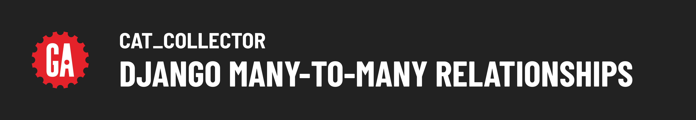
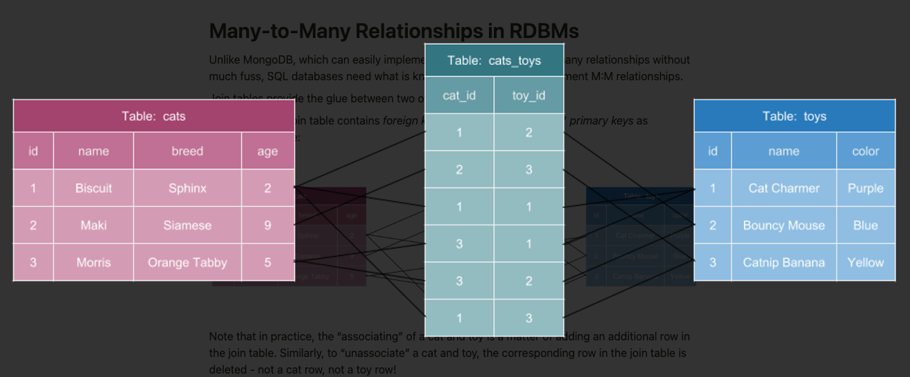
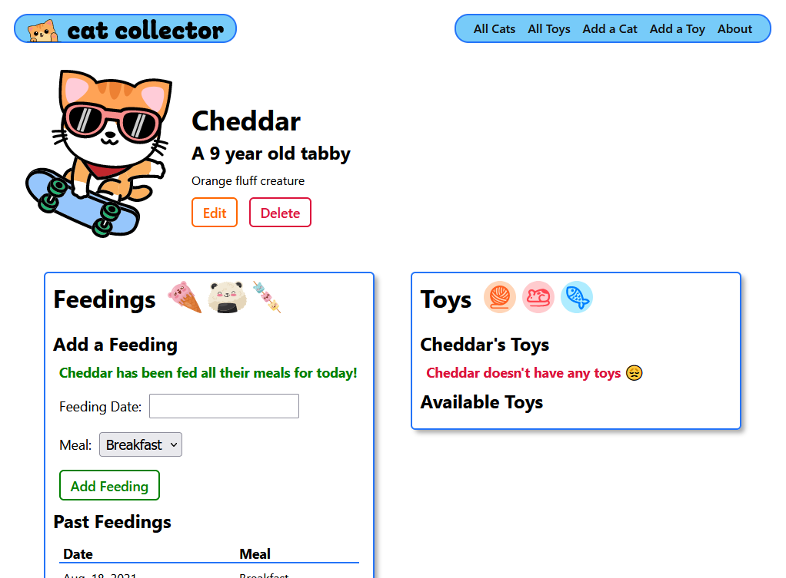
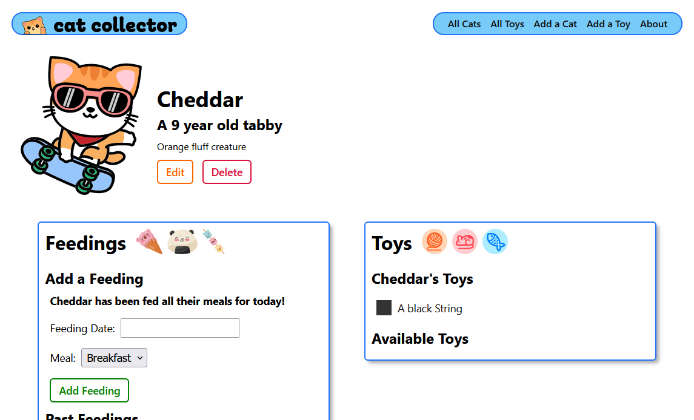
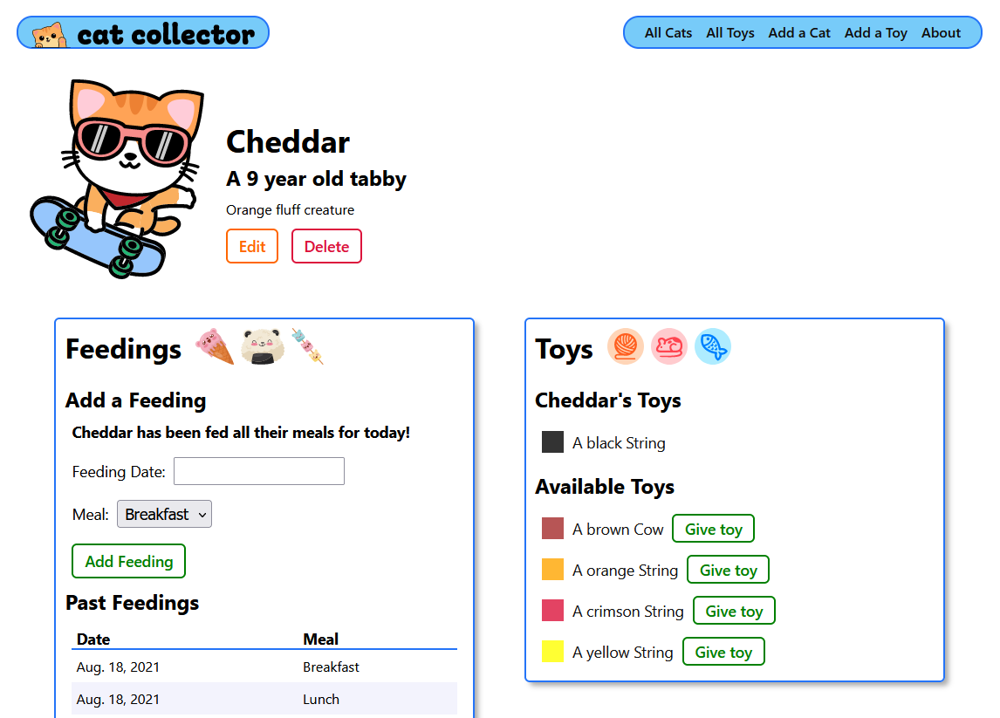

# 

**Learning objective:** By the end of this lesson, students will be able to tktk

# Intro

This lecture picks up from where [Details and a Rep](../details-rep/README.md) left off!

# Many-to-Many Relationships in RDBMs

Unlike MongoDB, which can easily implement both one and many-to-many relationships without much fuss, SQL databases need what is known as a **join table** to implement M:M relationships.

Join tables provide the glue between two other tables in a database.

Each row in the join table contains _foreign keys_ for the other two tables’ _primary keys_ as diagrammed here:

tktk - Hunter this is another one that wouldn't let me download but is from the notion content


Note that in practice, the “associating” of a cat and toy is a matter of adding an additional row in the join table. Similarly, to “unassociate” a cat and toy, the corresponding row in the join table is deleted - not a cat row, not a toy row!

# Many-to-Many Relationship in Django

As usual, the Django framework handles a lot of the heavy lifting when it comes to working with many-to-many Relationships between Models.

Forms and templates aside, all we need to do to implement a many-to-many relationship using Django is:

1. Add a `ManyToManyField` on one of the Models
2. Create the migration and migrate it to update the database

Django will ensure that a “hidden” join table is created that links the rows of the other two tables together.

## Add a `ManyToManyField` on One Side of the Relationship

To create a M:M relationship between two models, we need to add a `ManyToManyField` on one of them.

Django will still ensure that we can traverse data from both models to the related model, but we get to pick the name for the relationship attribute on the model we choose to add `ManyToManyField` to.

We more commonly be accessing a cat’s toys, than a toy’s cats, so we’ll add the new attribute to the `Cat` model:

```python
class Cat(models.Model):
  name = models.CharField(max_length=100)
  breed = models.CharField(max_length=100)
  description = models.TextField(max_length=250)
  age = models.IntegerField()
  # Add the M:M relationship
  toys = models.ManyToManyField(Toy)
```

> Tip: If you don't already have your `Toy` model above your `Cat` model, move it there now. This will save you from a `toy not defined` error.

## Make and Run the Migration

Because we’ve made a change to a Model that impacts the database’s schema, we must make a migration and migrate it to update the database with the terminal.

First, make the migration:

```bash
python3 manage.py makemigrations
```

Here’s how we can check the status of migrations:

```bash
python3 manage.py showmigrations
```

Now, let’s migrate the created migration to update the schema:

```bash
python3 manage.py migrate
```

We’re ready to test drive the new relationship ... after a quick bug fix!

## Bug Fix

Try making a new cat. You'll see a new form field: Toys.

This isn't great. Right now when we add a cat we are forced to give it at least one toy, which we may not want. We need to make sure this field isn't shown when a user is creating a cat. Let's do it!

**_Where do we need to make this change?_**

Here's the new `CatCreate` class in `main_app/views`:

```python
fields = ['name', 'breed', 'description', 'age']
```

# Implement the Cat & Toy Association in Cat Collector

## User Stories

_As a User, when viewing the detail page of a cat, I want to see a list of toys the cat has and be able to add toys to the list that the cat doesn’t already have_

## Displaying a List of Associated Toys

Displaying a cat’s toys is just a matter of updating `templates/cats/detail.html`:

```html
	  
	</section>
	 Add this section below the CLOSING tag (</section>) for <section class="feedings"> 
  <section class="toys">
    <div class="subsection-title">
      <h2>Toys</h2>
      
      
      
    </div>
    <h3>{{ cat.name }}'s Toys</h3>
    <div class="subsection-content">
      
        
          <div class="toy-container">
            <div
              class="color-block"
              style="background-color: {{ toy.color }}"
            ></div>
            <a href="">
              <p>A {{ toy.color }} {{ toy.name }}</p>
            </a>
          </div>
        
      
        <p class="no-toys">{{cat.name}} doesn't have any toys 😞</p>
      
    </div>
    <h3>Available Toys</h3>
    <div class="subsection-content">
       We'll display available toys here 
    </div>
  </section>
</div>
```

After saving and viewing the detail page for a cat, you’ll see something like this:

tktk - Hunter this is the image from the notion content


Let’s use the Django admin app (http://127.0.0.1:8000/admin) to add a toy or two then refresh the page:

tktk - Hunter this is the image from the notion content


## Displaying a List of Unassociated Toys

The next step would be to display toys that the cat is not associated with.

Each toy should include an ADD button that will add the toy to the list (implemented in the next step).

To be able to display the list of unassociated toys, we’ll need to query for them in the `cats_detail` view function and add them to the context being passed to the template.

The query to find all toys that a cat doesn’t have is a bit complicated, but it demonstrates the power of the Django ORM.

In `views.py` update `cats_detail` as follows:

```python
def cat_detail(request, cat_id):
  cat = Cat.objects.get(id=cat_id)
  # Get the toys the cat doesn't have
  toys_cat_doesnt_have = Toy.objects.exclude(id__in = cat.toys.all().values_list('id'))
  feeding_form = FeedingForm()
  return render(request, 'cats/detail.html', {
    # Add the toys to be displayed
    'cat': cat, 'feeding_form': feeding_form, 'toys': toys_cat_doesnt_have
  })
```

We’re using the manager’s `exclude` method to grab all toys that don’t need the condition passed to it.

The Django Query API enables **[Field Lookups](https://docs.djangoproject.com/en/4.2/ref/models/querysets/#field-lookups)** for every field in the model. `id__in` is one such field lookup that checks if the model’s `id` is in a list and that list is being created with this code:

```python
cat.toys.all().values_list('id')
```

Finally, we are passing the toys to the template by adding it to the context dictionary.

Now for more markup in `detail.py` to display the toys the cat doesn’t have:

```html
    <h3>Available Toys</h3>
    <div class="subsection-content">
       We'll display available toys here 
      
        
          <div class="toy-container">
            <div
              class="color-block"
              style="background-color: {{ toy.color }}"
            ></div>
            <a href="">
              <p>A {{ toy.color }} {{ toy.name }}</p>
            </a>
            <form action="" method="post">
              
              <button type="submit" class="btn submit">Give toy</button>
            </form>
          </div>
        
      
        <p class="all-toys">
          {{cat.name}} already has all the available toys 🥳
        </p>
      
    </div>
  </section>
</div>
```

Yup, pretty much like what we just added previously, except for a couple of changes.

An **ADD** form has been included, but the `action` attribute is currently empty because we’ll implement this feature in the next section and haven’t identified what the path will be yet.

Here’s what the updated UI looks like:

tktk - Hunter this is the image from the notion content


## Making the Association

The app is looking good and all that’s left is to handle the form being submitted to associate a toy with the cat.

To do this, the server needs to know the `id` of **both** the cat and the toy being associated.

Let’s first add a new URL pattern that makes sense in `urls.py`:

```python
path('cats/<int:cat_id>/add-feeding/', views.add_feeding, name='add-feeding'),
# associate a toy with a cat (M:M)
path('cats/<int:cat_id>/assoc-toy/<int:toy_id>/', views.assoc_toy, name='assoc-toy'),
```

As you can see, we’ve created two route parameters: `cat_id` and `toy_id`.

Now let’s make sure the form will post to this route.

Now that we know have defined the route and named it, we can use the `url` template tag to write out the proper URL in the available toy form’s `action`:

```html
<form action="" method="post">
  
  <button type="submit" class="btn submit">Give toy</button>
</form>
```

Note how we need to provide both `id`s as space-separated parameters in the order that they were defined in the path (first the cat’s id, then the toy’s).

We’re done as soon as we write the `views.assoc_toy`:

In `views.py`:

```python
def assoc_toy(request, cat_id, toy_id):
  # Note that you can pass a toy's id instead of the whole object
  Cat.objects.get(id=cat_id).toys.add(toy_id)
  return redirect('cat-detail', cat_id=cat_id)
```

We saw something similar to this earlier in when testing out the relationship in the shell.

Congrats on implementing a many-to-many relationship between cats and toys!

## You Do: Remove a Toy from a Cat

Implement the following user story:

_AAU, when viewing the detail page for a cat, I want to be able to remove a toy for that cat_
