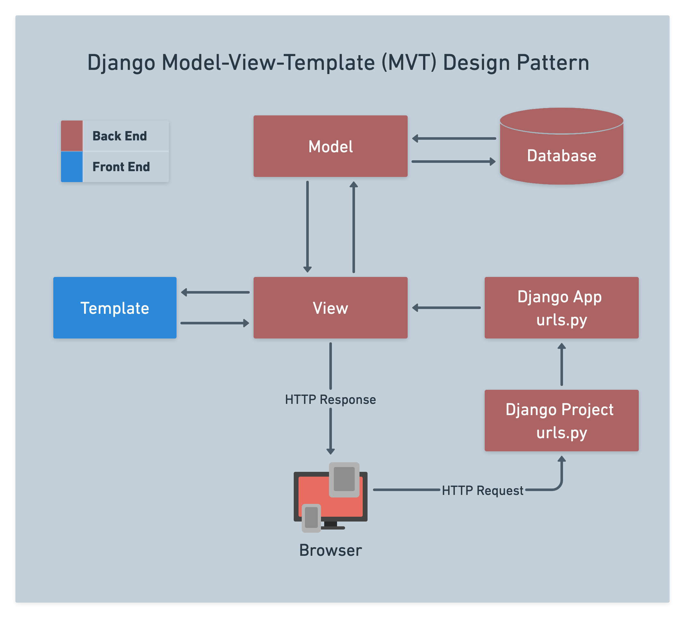
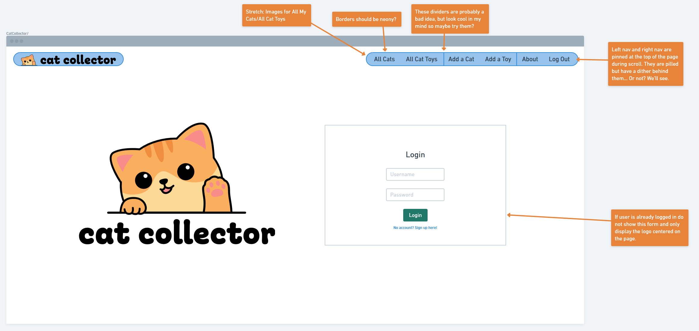
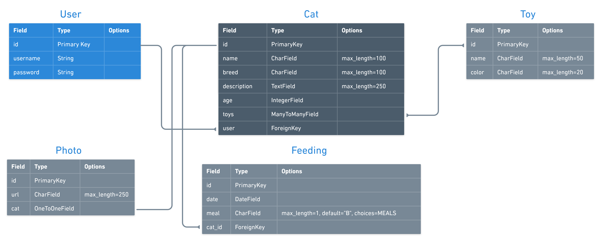
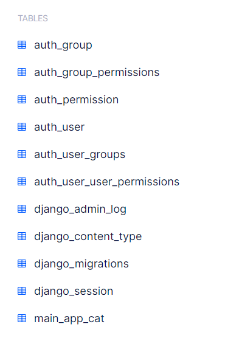
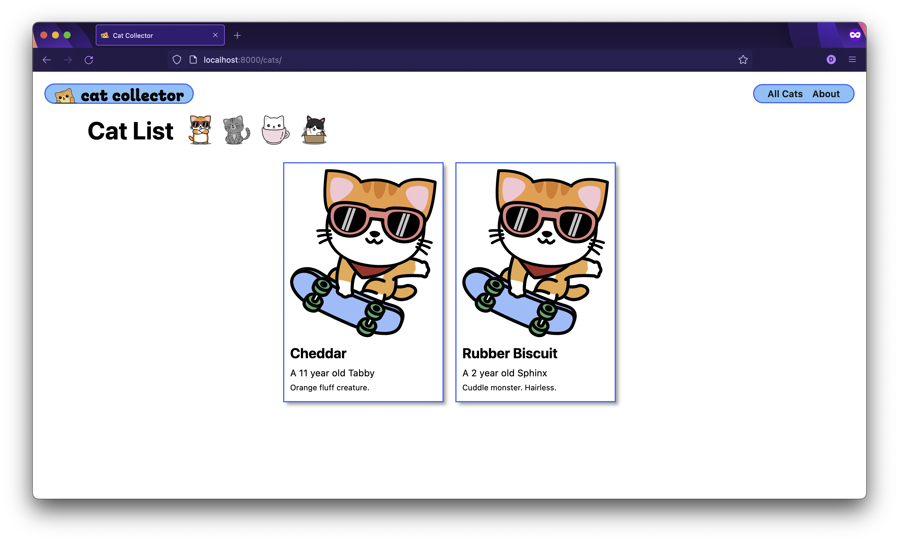
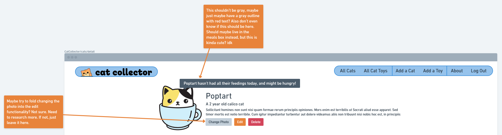
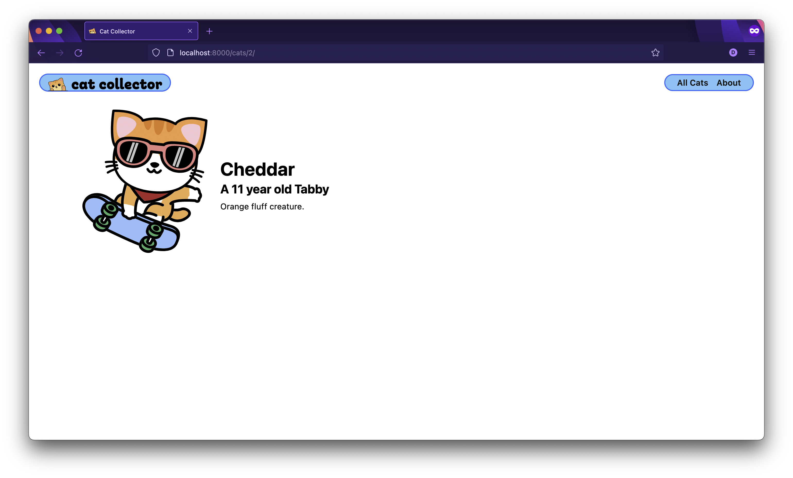

# 

**Learning objective:** By the end of this lesson, students will be able to tktk

# Intro

This lecture picks up from where [Django URLs, Views, and Templates](../urls-views-templates/README.md) left off!

# The Model Layer in the Django Architecture

tktk - Hunter this is the image from the notion content


This lesson focuses on the **Model layer** which provides **Views** with access to the **database**.

## Adjusting the `home` view function

Let’s ease into the day by creating a new home page. Here's a wireframe for us to reference:



Don't worry about the login functionality for now - we'll get to that in [Authentication](../authentication/README.md).

First we need a file, so in the terminal:

```bash
touch main_app/templates/home.html
```

Instead of using `HttpResponse` to send back a string, let's render `**home.html**`. 

```python
def home(request):
  return render(request, 'home.html')
```

> ❗ Note that since the `HttpResponse` function is no longer being used in `views.py`, its import can be removed.


Extend the template we're using as a base and add a simple `<section>`:

```html




<link rel="stylesheet" type="text/css" href=""/>




<section class="logo-container">
  <div class="cat-container">
    
  </div>
  
</section>


```

New html file, new CSS file, let's do it! In the terminal:

```bash
touch main_app/static/css/home.css
```

```css
main {
  display: flex;
  align-items: center;
  justify-content: center;
  flex-wrap: wrap;
  height: 100%;
}

main > section {
  width: 100%;
  padding: 10px 8px;
  display: flex;
  align-items: center;
  justify-content: center;
  flex-direction: column;
}

.header-logo-container {
  display: none;
}

.logo-container {
  max-width: 375px;
}

.cat-container {
  width: 80%;
}

.login {
  display: flex;
  flex-direction: column;
  justify-content: center;
  align-items: center;
  width: 80%;
}

.login h1 {
  font-size: clamp(3.2rem, 3vw, 4.8rem);
  margin: 10px 0;
}

.login > p {
  display: flex;
  flex-direction: column;
  width: 100%;
  margin: 14px 0 0px;
}

.login label {
  font-size: var(--font-reg);
  margin-bottom: 6px;
}

.login input {
  font-size: var(--font-l);
  padding: 2px 4px;
}

.login .btn {
  align-self: flex-end;
  margin-right: 0;
  margin-top: 16px;
}

@media only screen and (min-width: 768px) {
  main {
    justify-content: space-around;
  }

  main > section {
    width: 40%;
  }

  .login {
    border: var(--borders);
    padding: 20px;
    border-radius: var(--card-border-radius);
    box-shadow: var(--card-box-shadow);
    width: 100%;
  }

  .logo-container {
    max-width: 520px;
  }
}
```

# What’s a Model?

**Models** are used to perform CRUD data operations on a database.

Remember **entities** in the Entity-Relationship-Diagrams?

A Django Model represents a single entity from the ERD.

Thus, a Model has a one-to-one mapping with a table in the database and is what allows us to perform create, read, update and delete data operations on that table.

When we retrieve data from the database (using a Model of course), we will have **model objects**, each of which represents a row in a database table. Model objects are also called *instances* of the Model. We can work with these instances of the Model just like how we worked with Mongoose documents.

> Note: Since a “model” can technically refer to the Model class or an instance of that class, we will try to use “Model” (capitalized) to refer to a Model class we use to perform CRUD with and “model” (lowercased) to refer to a model instance.

Here's our final ERD for Cat Collector:

tktk - Hunter this is the image from the notion content


# Models in Django

Each Model is defined as a Python class that inherits from `django.db.models.Model`.

Here’s the **Cat** entity from an ERD and the code to define the equivalent Model:

tktk - Hunter this is the image from the notion content


All of the Models for an app are defined in the app’s `models.py` file.

Let’s create the `Cat` Model!

Note that each field (attribute) is represented by a Field class, e.g., `CharField`. Here are the **[docs of available Field types](https://docs.djangoproject.com/en/4.2/ref/models/fields/#model-field-types)** - there’s plenty of options.

It’s important to note that the Field types for a Model don’t just determine the column’s data type in the table, Django also uses this information:

- To implement some validation in automatically-generated forms.
- To determine the default HTML **[widget](https://docs.djangoproject.com/en/4.2/ref/forms/widgets/)** to render in forms for the Model. For example, a `CharField` uses a `<input type="text">` as its *widget*, whereas, a `TextField` uses a `<textarea>`.

## Adding a `__str__` Method

It’s a best practice to override the `__str__` method in Models so that they will print in a more helpful way.

For the `Cat` model, we’ll code `__str__` to return the cat’s `name` attribute:

```python
...
  age = models.IntegerField()

	# new code below
  def __str__(self):
    return self.name
```

Watch your indentation here! This is a class method so it belongs in the `Cat` class.

## Review Questions ❓

<details>
<summary>In Django, what is used to perform CRUD database operations?</summary>
    
**A Model**
</details>

<details>
<summary>How is a Model defined in Django?</summary>
    
**With a Python class**
</details>

<details>
<summary>An ERD Entity maps to a _____ in Django, which maps to a _____ in the database.</summary>

An ERD Entity maps to a **Model** in Django, which maps to a **table** in the database.
</details>

## Connecting to the Database

We'll need a new package to work with our database, so we'll need to install that into our virtual environment. Install the package by running the following command in the terminal:

```bash
pipenv install psycopg2-binary
```

We should see it added to our `Pipfile`.

Once we have this package, we'll be able to tell Django to use PostgreSQL instead of the default, which is a very minimalist database called SQLite3.

Open up **`catcollector/settings.py`** and locate this code:

```py
DATABASES = {
    'default': {
        'ENGINE': 'django.db.backends.sqlite3',
        'NAME': os.path.join(BASE_DIR, 'db.sqlite3'),
    }
}
```

Currently, Django is defaulted to using this sqlite3 database. This would be fine, but we want to use PostgreSQL instead.

Update the above to look like:

```py
DATABASES = {
    'default': {
        'ENGINE': 'django.db.backends.postgresql',
        'NAME': 'catcollector',
    }
}
```

The name of our database can be anything we want, but ideally it's something that will make sense for our project.

> **Windows Note:** Windows users may need to provide a `USER` and `PASSWORD` as well as `ENGINE` and `NAME`. The `USER` will be `postgres`, and the `PASSWORD` will be the password you set up for your PostgreSQL user and use to sign into the PostgreSQL shell.

# Making and Running Migrations

## What are Migrations?

**[Migrations](https://docs.djangoproject.com/en/4.2/topics/migrations/)** are used to synchronize a database’s schema with the app’s Models.

Migrations are used to evolve a database over time - as the requirements of the application change. However, they can be “destructive” (cause a loss of data), so be careful with migrations if you’re working with an application in *production*.

Migrations in Django are Python files that are created by running a command Django in Terminal.

## Making Migration Files

Okay, we’ve defined a `Cat` Model, but the database does not yet have a table to hold all of our furry model instances (rows).

Run the following command in the terminal to create migration files for all Models that have been added or changed since the last migration:

```bash
python3 manage.py makemigrations
```

The output in the terminal informs us that the following migration file was created: `main_app/migrations/0001_initial.py`

A `migrations` directory is created for an **app** the first time you run `makemigrations`.

You don’t have to do anything with the migration files, but since this is the first time we’ve made one, let’s open it and take a peek.

> 🤯 You shouldn’t ever need to edit migration files by hand, but it’s entirely possible to do so if you needed to (please don’t in this course though).

## Running Migrations

Simply creating migration files does not update the database’s schema.

To synchronize the database with the code in the migration files, we “migrate” using this command in the terminal:

```bash
python3 manage.py migrate
```

`OK` messages are a what you want!

> 💡 The rule of thumb is: If you touch a model, you should make and run migrations.

>🚨 If you work in a group on a Django project only one person should ever make migrations, but everyone in the group will migrate.

## What Exactly Was Created in the Database?

To check out the database to see this table being added, we can use our `psql` command in the terminal:

```bash
psql catcollector
```

Then, we can list the tables in the database:

```sql
\dt
```

You should see a table named `main_app_cat` listed!

tktk - Hunter this is the image from the notion content


You’ll find quite a few tables named like `django_*`. These tables are used by the framework to track migrations, server-side sessions, etc.

You’ll also find several tables named like `auth_*`. These were created by the `django.contrib.auth` app that’s listed in the `INSTALLED_APPS` variable within `settings.py`.

## Review Questions ❓

<details>
<summary>What are used to update a database’s schema over time as an application’s functionality evolves?</summary>

**Migrations**
</details>

<details>
<summary>When is it necessary to make and run migrations?</summary>

**Whenever a Model is added or updated in a way that impacts the database’s schema.**
</details>

# Performing CRUD Using Django’s ORM

## What’s an ORM?

ORM stands for Object-Relational Mapper.

It’s called that because it creates Python objects from rows in a relational database table and vice-versa.

The ORM allows developers to write object-oriented code to CRUD data instead of using SQL directly.

ORMs make application developers more productive.

The fact is, the ORM in Django can generate SQL that even the most experienced developer would struggle to write.

Another benefit is that the ORM & Model layer abstracts away the differences between the flavors of SQL that exists - we get to write the same Python code to perform CRUD operations, regardless of which database is being used.

## Django’s ORM

The Django ORM is automatically going to generate a plethora of methods for each Model.

Django’s ORM includes methods for performing:

- Filtering (querying based on criteria)
- Ordering
- Even accessing the data from related Models!

Django refers to the ORM functions available as its **[database API](https://docs.djangoproject.com/en/4.2/topics/db/queries/)**. Additional documentation for Models can be **[found here](https://docs.djangoproject.com/en/4.2/ref/models/)**.

## Performing CRUD in a Python Interactive Shell

After creating a new Model, you can take it for a test drive using a Python shell that loads the Django environment. Run this in the *terminal:

```bash
python3 manage.py shell
```

You’re now in a Python shell with your Django environment loaded in your terminal! Dizzy yet?

Any model you want to work with must be imported just like you will have to do in the application:

```python
from main_app.models import Cat
```

<aside>
💡 Key Point: The code we type in the shell to perform CRUD is going to be the same or extremely similar to the code we use in the application’s views, so even though we’re working in the shell start internalizing some of this so that you can apply it in your apps!

</aside>

To retrieve all of the Cat objects, enter this command:

```python
Cat.objects.all()
```

You’ll see a `<QuerySet []>` returned from this command!

### Django Model Manager

Any time you want to perform query operations on a **Model** to retrieve *model objects* (rows) from a database table, it is done via a **Manager** object.

By default, Django adds a Manager to every Model class - this is the `objects` attribute attached to `Cat` above.

### **The `<QuerySet>`**

The `<QuerySet []>` returned represents a database query that can be refined by chaining additional methods to it.

Ultimately though, when the app needs the data, for example, to iterate over cats, the query will be sent to the database and the result is a list-like object that represents a collection of model instances (rows) from the database.

Besides `Cat.objects.all()`, let’s see some of the other common ORM operations…

## Give Me a “C”

Here’s how we can create an in-memory model (an instance of a Model) and then save it to the database:

```python
c = Cat(name='Biscuit', breed='Sphinx', description='Cuddle monster. Hairless.', age=2)
```

As you can see, we pass the data for the model’s attributes as kwargs.

> 💡 The model currently has None as its id because it is not yet saved to the database. Let’s do that next!

```python
c.save()
```

And now as if by magic:

```python
c.id
```

Will return a `1`. We’ve crated a cat!

## Give Me a “R”

If you call `Cat.objects.all()` again you’ll see a `Cat` object exists now:

```python
Cat.objects.all()
```

`<QuerySet [<Cat: Biscuit>]>` should be returned!

We’re reading cats! You should also now be able to see Biscuit in bit.io!

## You Do 💪

Create another `Cat` with attribute values of your choice.

Note that you can re-use the variables in your code, such as `c` above, unless there’s a reason you need to hold onto the current object held by `c`.

Check that your cat was added by using `Cat.objects.all()`.

## Give Me a “U”

A single attribute value can be updated by simply assigning the new value and calling `save()`. Start by getting the cat we want to update - in this case the first one:

```bash
c = Cat.objects.first()
```

Confirm it’s the cat we want:

```python
c
```

Which will output `<Cat: Biscuit>`. Let’s change Biscuit’s name:

```python
c.name = 'Rubber Biscuit'
```

And save this cat:

```python
c.save()
```

We’ve updated a cat!

## Filtering (querying) for Records

We can use **[objects.filter()](https://docs.djangoproject.com/en/4.2/ref/models/querysets/#filter)** to query a Model’s table for data that matches a criteria similar to how we used the `find` Mongoose method.

For example, this query would return all cats with the name “Rubber Biscuit”:

```python
Cat.objects.filter(name='Rubber Biscuit')
```

Using `objects.filter()` and `objects.exclude()` is like writing a `WHERE` clause in SQL.

The Django ORM creates several helpful **[Field lookups](https://docs.djangoproject.com/en/4.2/topics/db/queries/#field-lookups)**.

For example if we wanted to query for all cats whose names *contain* a string:

```python
Cat.objects.filter(name__contains='Bis')
```

The above’s SQL equivalent would be something like:

```sql
SELECT * FROM main_app_cat WHERE name LIKE '%Bis%';
```

As another example, here’s how we can find cats that have an age *equal to or less than* 3:

```python
Cat.objects.filter(age__lte=3)
```

> 🧠 For basic lookups, the format is: `field__lookuptype=value` (that’s a double underscore).

The above `filter` operation is similar to executing the following SQL:

```sql
SELECT * FROM main_app_cat WHERE age <= 3;
```

Filters can even be chained!

## Read One Record

You’ve seen how `Cat.objects.all()` and `Cat.objects.filter()` returns a list of objects.

However, it’s a very common data operation to read one specific model object from the table based on some provided value, usually its `id` (it’s like we’ve done things like this before)!

Instead of the `objects.all()` method, we can use the `get()` method like this:

```bash
Cat.objects.get(id=1)
```

The `get()` method can also be called with multiple `field=value` arguments to query multiple columns.

Be sure to use error handling if there’s a chance that `get()` won’t find what you’re looking for because if Django doesn’t find it, an error is raised.

## What About Ordering (sorting)?

Similar to what you saw in SQL, there’s an **[order_by](https://docs.djangoproject.com/en/4.2/ref/models/querysets/#order-by)** method:

```python
Cat.objects.order_by('name')
```

Or in descending order:

```python
Cat.objects.order_by('-age')
```

The `<QuerySet>` object can be indexed and sliced like other sequences too.

Poor old cat:

```python
Cat.objects.order_by('-age')[0]
```

# Let’s Get Coding!

Time to add some of this ORM magic to the Cat Collector app!

Currently, we are “faking” the data with a `list` of cats.

Time to update `**main_app/views.py**`…

First let’s be sure to remove the `class Cat...` and the `cats` list.

Now let’s write the code that uses the `Cat` Model to read all of the cat objects:

```python
from django.shortcuts import render
from .models import Cat

...

def cat_index(request):
  cats = Cat.objects.all()
  return render(request, 'cats/index.html', { 'cats': cats })
```

Don’t forget to import the `Cat` Model too!

Refresh the page and you should see something like this:



Nice!

# I am the Admin!

But wait, there’s another really REALLY ***REALLY*** neat thing about Django - it comes with built-in administrator functionality! Remember that `django.contrib.auth` in the `INSTALLED_APPS`? Let’s use it!

A *super user* is an administrator for the site. When you are logged in to this account, you can access the Admin app to add additional users and manipulate Model data.

Run this command in the terminal:

```bash
python3 manage.py createsuperuser
```

Django will want you to create a password that’s at least 8 characters long and complex, however, you can bypass it by typing `y` at the warning prompt.

You will be prompted to enter a username, email address, and a password.

Now go to your webpage and head over to the `/admin` route to see an *administration* portal!

Did you mess up your password? It’s no biggie. Go back to your terminal and use this handy command:

```bash
python3 manage.py changepassword <user_name>
```

But I don’t see **Cats**! That’s because in order to manipulate Cat data, we need to “register” the `Cat` Model so that the admin portal knows about.

We register our Models in the `main_app/admin.py` file:

```python
from django.contrib import admin
# import your models here
from .models import Cat

# Register your models here
admin.site.register(Cat)
```

No need to restart the server - just refresh the page!

We can add, edit, and remove data objects anytime we need to by browsing to `/admin`. Neat!

# Adding a Cat Details Page

Typically, the *index* page showing all cats would only show a summary of each cat’s info. For example, just their name perhaps.

Then, it would be commonplace to show the details for a data object using a separate page that results from the user clicking on that summary info - in this case, the cat’s card in **`index.html`**.

Here's a wireframe for what we're going to tackle in this part, but we'll be adding to this page later.



## Typical Process to Add Functionality to an App

Remember, nothing is going to happen unless an HTTP request leaves the browser informing the server what the app wants to do.

When adding additional functionality to a web app we need to do the following:

1. With Django, decide the appropriate URL for the route. Because Django does not follow the RESTful routing methodology, you are free to name the URLs as you see fit.
2. Add the UI that is going to trigger the HTTP request to be sent to the server. For example, adding a `<form>` to submit a new cat.
3. Code the route on the server. In the case of Django, this is done by adding an additional `path(...)` to the `urlpatterns` list within the app’s `**urls.py**` module. **Each entry in `urlpatterns` determines what code will run when the URL matches an HTTP request**.
4. Now you need to add the *view function* referenced by the `path(...)` inside of the `**views.py**` module. The *view function* contains the code to perform CRUD, etc. It ultimately is responsible for responding to the client’s request…
5. If data was changed, respond with a **redirect**. Otherwise, you’ll typically **render** a *template*, optionally passing data to it. If a *template* is required, write it and you’re done - other than debugging.

Make it a habit to follow the steps above anytime you need new functionality in your app.

### Step 1

In Django, we don’t worry about the HTTP method (verb), unless we’re writing a `<form>` to do searching, in which case, we would switch from the form’s default method of `POST` to a `GET`.

So what’s the URL for viewing a single cat’s detail page?

For sure we need to capture the `id` of the cat we want the details for in the URL. In Django, we use angle brackets to declare a *URL parameter* to capture values within the *segments* of a URL as follows.

Let’s go with this: `cats/<int:cat_id>/`

The `int:` part is called a converter and it’s used to match and convert the captured value from a string into, in this case, an integer. If the info in the segment does not look like an integer, then it will not be matched - this is different than what we saw in Express where the type of info in a segment didn’t matter.

### Step 2

As far as the UI is concerned, clicking on a cat’s card in the `**index.html**` should trigger the request to the server to view the details of a cat.

We can accomplish this by wrapping the card’s content with an `<a>` tag and setting its `href` appropriately:

```html
<section class="card-container">
  
    <div class="card">
       Add this line 
      <a href="/cats/{{ cat.id }}">
        <div class="card-content">
          <div class="card-img-container">
            
          </div>
          <h2 class="card-title">{{ cat.name }}</h2>
          
            <p>A {{ cat.age }} year old {{ cat.breed }}</p>
          
            <p>A {{ cat.breed }} kitten.</p>
          
          <p><small>{{ cat.description }}</small></p>
        </div>
       And this line 
      </a>
    </div>
  
</section>
```

The above is pretty similar to what we did in EJS templates.

After refreshing the page, hover over a cat card and check the URL in the bottom-left of the browser window. It should look something like: `**http://localhost:3000/cats/2**`.

Cool, on to the next step…

### Step 3

Now that clicking a cat card is going to send a request like `GET /cats/1`, we need to add a new route entry to the `urlpatterns` list in `**urls.py**` that will match this request:

```python
urlpatterns = [
  path('', views.home, name='home'),
  path('about/', views.about, name='about'),
  path('cats/', views.cat_index, name='cat-index'),
  # new route below 
  path('cats/<int:cat_id>/', views.cat_detail, name='cat-detail'),
]
```

### Step 4

As you know, *view functions* are defined within `**views.py**`.

Here’s the new `cat_detail` function:

```python
...

def cat_detail(request, cat_id):
  cat = Cat.objects.get(id=cat_id)
  return render(request, 'cats/detail.html', { 'cat': cat })
```

The `cat_detail` function is using the `get` method to obtain the cat object by its `id`.

>💡 Django will pass any captured URL parameters as a named argument to the view function!

> ❓ What determined the parameter name of cat_id in the cat_detail view function?

### Step 5

So we want to render the cat data within a `**detail.html**` template…

The `cat_detail` view function is passing a dictionary of data (called the *context*) to a template called `**detail.html**`.

Create that `**detail.html**` template with the following command in the terminal:

```bash
touch main_app/templates/cats/detail.html
```

Now let’s add the following template code:

```html




<link 
  rel="stylesheet" 
  type="text/css" 
  href=""
/>




<section class="cat-container">
  <div class="cat-img">
    
  </div>
  <div class="cat-details">
    <h1>{{ cat.name }}</h1>
    
      <h2>A {{ cat.age }} year old {{ cat.breed }}</h2>
    
      <h2>A {{ cat.breed }} kitten.</h2>
    
    <p>{{ cat.description }}</p>
  </div>
</section>


```

>❓ **What’s that ` ` business about?**

Don't forget your CSS! Run the following command in the terminal:

```bash
touch main_app/static/css/cats/cat-detail.css
```

And here’s the content of that file:

```css
.cat-container {
  padding: 35px 30px;
  display: flex;
  flex-direction: column;
  align-items: center;
  justify-content: center;
}

.cat-img {
  width: 75%;
  max-width: 350px;
}

.usr-img {
  width: 100%;
  border-radius: var(--card-border-radius);
}

.cat-details {
  width: 98%;
}

.cat-actions {
  margin-top: 20px;
}

.feedings-toy-container {
  display: flex;
  flex-direction: column;
  padding-bottom: 20px;
  align-items: center;
}

.subsection-title {
  display: flex;
  align-items: center;
  margin-bottom: 12px;
}

.subsection-content {
  margin: 0 8px;
}

.toy-container {
  display: flex;
  align-items: center;
  flex-wrap: wrap;
}

.color-block {
  opacity: 0.8;
  height: 25px;
  width: 25px;
  margin-right: 10px;
}

.unfed,
.fed,
.no-toys,
.all-toys {
  margin: 0;
  font-weight: bold;
}

.unfed,
.no-toys {
  color: var(--danger);
}

.fed,
.all-toys {
  color: var(--submit);
}

.cat-details h1 {
  font-size: var(--font-xxl);
  margin: 15px 0 3px;
}

.cat-details h2 {
  font-size: var(--font-xl);
  margin: 0 0 10px;
  margin-top: 0;
  margin-bottom: 10px;
}

.cat-details h3 {
  margin: 20px 0 10px;
  font-size: var(--font-l);
}

.cat-details p {
  font-size: var(--font-reg);
  margin: 5px 0;
}

.feedings-toy-container > section {
  width: 80%;
  min-width: 360px;
  border: var(--borders);
  border-radius: var(--card-border-radius);
  padding: 10px;
  box-shadow: var(--card-box-shadow);
  display: flex;
  flex-direction: column;
  justify-content: center;
  margin-bottom: 20px;
}

.subsection-title img {
  height: 42px;
  margin-left: 8px;
}

.subsection-title img:first-of-type {
  margin-left: 16px;
}

.feedings h2,
.toys h2 {
  font-size: 3.2rem;
  margin: 0;
}

.feedings h3,
.toys h3 {
  font-size: var(--font-xl);
  margin: 10px 0;
}

.subsection-content p,
.subsection-content input,
.subsection-content select {
  font-size: var(--font-l);
}

.subsection-content input,
.subsection-content select {
  margin-left: 5px;
  padding: 3px;
}

.feedings table {
  width: calc(100% - 16px);
  text-align: left;
  border-collapse: collapse;
  margin: 0 8px;
}

.feedings td {
  padding: 8px 5px;
  font-size: var(--font-reg);
}

.feedings th {
  font-size: var(--font-l);
  padding: 5px 5px 0;
  border-bottom: rgb(36, 116, 248) solid 2px;
}

.feedings tr:nth-child(even) {
  background-color: #f3f3fd;
}

.toy-container p {
  margin: 12px 0;
}

.toy-container a {
  text-decoration: none;
  color: #111;
}

.toy-container .btn {
  padding: 3px 10px;
  margin-left: 10px;
}

#file-input {
  overflow: hidden;
  position: absolute;
  width: 0.1px;
  height: 0.1px;
}

#file-name {
  margin-bottom: 10px;
}

@media only screen and (min-width: 768px) {
  .cat-container {
    padding: 35px 30px;
    flex-direction: row;
    align-items: center;
    justify-content: start;
  }

  .cat-img {
    width: 25%;
    max-width: 250px;
    margin-right: 25px;
  }

  .feedings-toy-container {
    flex-direction: row;
    justify-content: space-around;
    align-items: flex-start;
  }

  .feedings-toy-container > section {
    width: 45%;
  }
}

@media only screen and (min-width: 1024px) {
  .feedings-toy-container {
    padding: 0 40px;
  }
}
```


​
Okay, let’s refresh and check it out!

tktk - Hunter this is the image from the notion content


## Removing Hand-coded URLs in Templates

Although everything works nicely, hand-coding the URLs in templates, is not considered a good practice because during development, URL’s may change.

For example, in `**index.html**`, we find:

```html
...
<div class="card">
  <a href="/cats/{{ cat.id }}">
  ...
```

Django has a better way!

Let’s take another look at the `urlpatterns` in `**urls.py**`:

```python
urlpatterns = [
  path('', views.home, name='home'),
  path('about/', views.about, name='about'),
  path('cats/', views.cat_index, name='cat-index'),
  path('cats/<int:cat_id>/', views.cat_detail, name='cat-detail'),
]
```

That `name` argument within each `path` is used to obtain the correct URL in templates using DTL’s `url` template tag!

In `index.html`, replace this code:

```html
<a href="/cats/{{cat.id}}">
```

With this code:

```html
<a href="">
```

The above is the Django way.

**Congrats on coding the Django `Cat` Model and adding the *detail* functionality for the Cat Collector.**