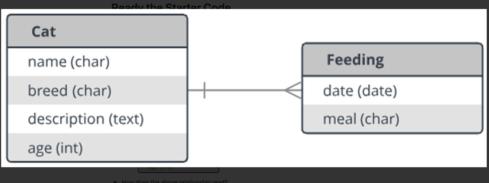
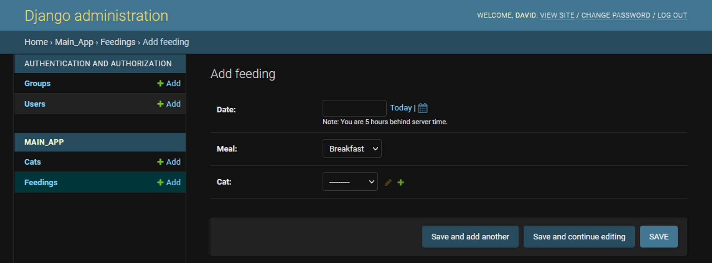
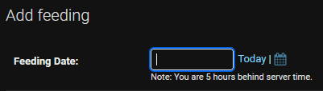
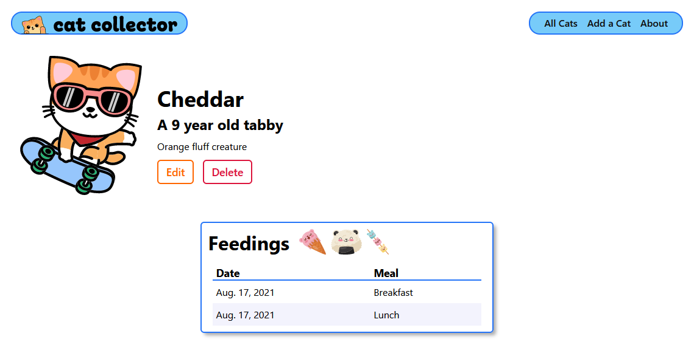
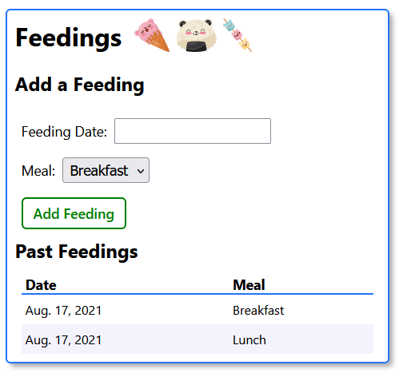
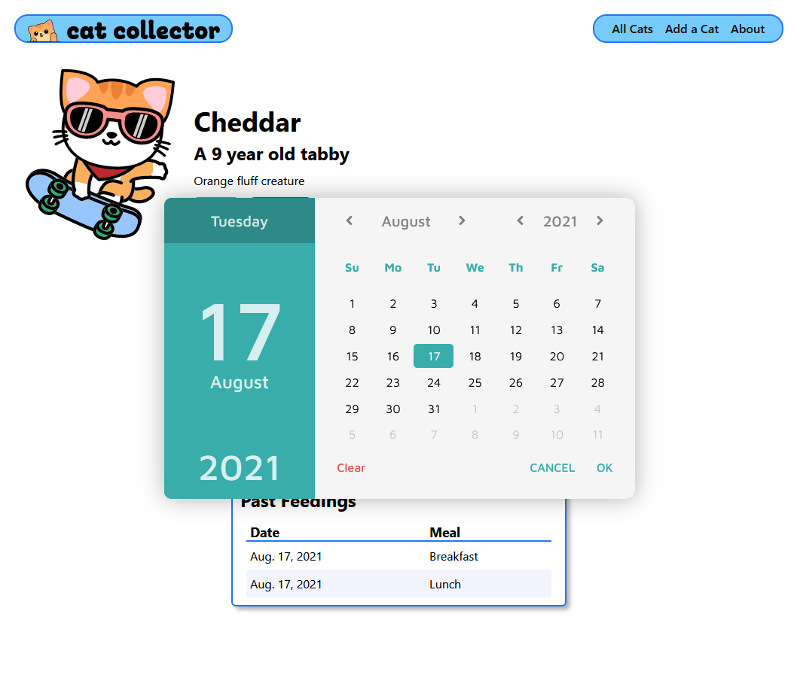
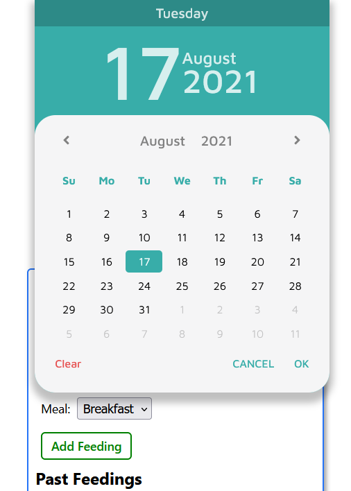
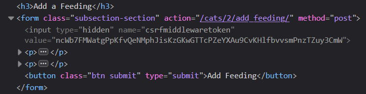
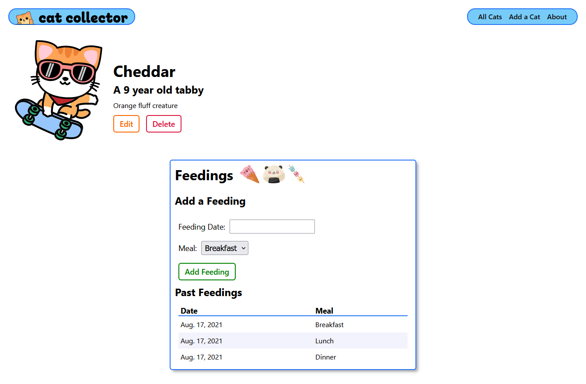

# 

**Learning objective:** By the end of this lesson, students will be able to tktk

# Ready the Starter Code

This lesson will pick up from where [Django Class-based Views](../class-based-views/README.md) left off.

# A Cat’s Got to Eat!

In this lesson we’re going to look at how to add another model that demonstrates working with **one-to-many** relationships in Django.

Let’s go with this relationship:

tktk - Hunter, sorry this is not the original from the notion content. For some reason this one would not let me save as and it's not am imgur link.


<details>
<summary>How does the above relationship read?</summary>

“A Cat has many Feedings” -and- “A Feeding belongs to a Cat”
</details>

# Add the New `Feeding` Model

<details>
<summary>What file are we going to add the new Feeding Model in?</summary>

`**main_app/models.py**`
</details>

## Creating the basics for the `Feeding` Model

Using the ERD above as a guide, let’s add the new `Feeding` Model (below the current `Cat` Model):

```python
# Add new Feeding model below Cat model
class Feeding(models.Model):
  date = models.DateField()
  meal = models.CharField(max_length=1)
```

Note that we’re going to use just a single-character to represent what meal the feeding is for: **B**reakfast, **L**unch or **D**inner…

## Field.choices

Django has a feature, **[Field.choices](https://docs.djangoproject.com/en/4.2/ref/models/fields/#choices)**, that will make the single-characters more user-friendly by automatically generating a select dropdown in the form using descriptions that we define.

The first step is to define a tuple of 2-tuples. Because we might need to access this tuple within the `Cat` class also, let’s define it above both of the Model classes:

```python
# A tuple of 2-tuples
MEALS = (
  ('B', 'Breakfast'),
  ('L', 'Lunch'),
  ('D', 'Dinner')
)
# new code above

class Cat(models.Model):
```

As you can see, the first item in each 2-tuple represents the value that will be stored in the database, e.g. `B`.

The second item represents the human-friendly “display” value, e.g., `Breakfast`.

Now let’s enhance the `meal` field as follows:

```python
class Feeding(models.Model):
  date = models.DateField()
  meal = models.CharField(
    max_length=1,
    # add the 'choices' field option
    choices=MEALS,
    # set the default value for meal to be 'B'
    default=MEALS[0][0]
  )
```

## Add the `__str__` Method

As recommended, we should override the `__str__` method to Models so that they provide more meaningful output when they are printed:

```python
class Feeding(models.Model):
  ...

  def __str__(self):
    # Nice method for obtaining the friendly value of a Field.choice
    return f"{self.get_meal_display()} on {self.date}"
```

Check out the convenient `get_meal_display()` method Django automagically creates to access the human-friendly value of a Field.choice like we have on `meal`.

## Add the Foreign Key

Since a `Feeding` **belongs to** a `Cat`, it must hold the `id` of the cat object it belongs to - yup, it needs a **foreign key**!

Here’s how it’s done - Django style:

```python
class Feeding(models.Model):
  date = models.DateField()
  meal = models.CharField(
		max_length=1,
		choices=MEALS,
		default=MEALS[0][0]
  )
  # Create a cat_id column in the database
  cat = models.ForeignKey(Cat, on_delete=models.CASCADE)

  def __str__(self):
    return f"{self.get_meal_display()} on {self.date}"
```

As you can see, the `ForeignKey` field-type is used to create a one-to-many relationship.

The first argument provides the parent Model.

In a one-to-many relationship, the `on_delete=models.CASCADE` is required. It ensures that if a Cat record is deleted, all of the child Feedings will be deleted automatically as well - thus avoiding *orphan* records.

> 🧠 In the database, the column in the feedings table for the FK will actually be called cat_id because Django by default appends _id to the name of the attribute we use in the Model.

# Make and Run the Migration

We changed our `models.py` file, so it’s that time again! Open your terminal and run:

```bash
python3 manage.py makemigrations
```

<details>
<summary>Now what’s the next command we need to type?<summary>

```bash
python3 manage.py migrate
```
</details>
    

# Don’t Forget the Admin Portal

You know about the Django Admin Portal now so we're going to skip out on adding data in the Django shell (check out the **Level Up 🚀** if you want to see some examples of this with a feeding).

Remember, before a Model can be CRUD’d using the built-in Django admin portal, the Model must be registered.

Update `**main_app/admin.py**` so that it looks as follows:

```python
from django.contrib import admin
# add Feeding to the import
from .models import Cat, Feeding

admin.site.register(Cat)
# register the new Feeding Model 
admin.site.register(Feeding)
```

Now browse to http://localhost:3000/admin and click on the **Feeding +Add** link.

tktk - Hunter this is the image from the notion content


Check out those select drop-downs for assigning both the Meal and the Cat!

## Custom Field Labels

Let’s say though that you would like a less vague label than **Date**.

Because Django subscribes to the philosophy that **a Model is the single, definitive source of truth about your data**, you can bet that’s where we will add customization.

In `**main_app/models.py**`, add the desired user-friendly label to the field-type like so:

```python
class Feeding(models.Model):
  # the first optional positional argument overrides the label
  date = models.DateField('Feeding date')
  ...
```

Refresh and…

tktk - Hunter this is the image from the notion content


What’s cool is that the custom labels will be used in all of Django’s `ModelForm`s too!

Go ahead and add a few feedings to each of your cats now

# Displaying a Cat’s Feedings

Just like it would make sense in an app to show *comments* for a *post* when that post is displayed, a cat’s *detail* page is where it would make sense to display a cat’s feedings.

No additional views or templates necessary. All we have to do is update the **`detail.html`**.

Here’s the new content of `**detail.html**`. Best to copy/paste this new markup, then we’ll review:

```html
    </div>
  </div>
</section>
 Existing cat-container above 
<div class="feedings-toy-container">
  <section class="feedings">
    <div class="subsection-title">
      <h2>Feedings</h2>
      
      
      
    </div>
    <table>
      <thead>
        <tr><th>Date</th><th>Meal</th></tr>
      </thead>
      <tbody>
        
          <tr>
            <td>{{feeding.date}}</td>
            <td>{{feeding.get_meal_display}}</td>
          </tr>
        
      </tbody>
    </table>
  </section>
</div>


```

A refresh results in this:

tktk - Hunter this is the image from the notion content


# Adding New Feeding Functionality

Now we want to add the capability to add a new feeding when viewing a cat’s details.

Previously we used class-based views to productively perform create and update data operations for a Model.

The CBV we used automatically created a `ModelForm` for the Model that was specified like this: `model = Cat`.

The CBV then used the `ModelForm` behind the scenes to generate the inputs and provide the posted data to the server.

Because we want to be able to show a form for adding a **feeding** on the *detail* page of a **cat**, we’re going to need to create a custom `ModelForm` from scratch that will:

1. Generate a feeding’s inputs inside of the `<form>` tag we provide.
2. Be used to validate the posted data by calling `is_valid()`.
3. Persist the model instance to the database by calling `save()` on the instance of the ModelForm.

There’s several steps we’re going to need to complete, so let’s get started…

## Create the ModelForm for the `Feeding` Model

We could define the `ModelForm` inside of the `models.py` module, but we’re going to follow a best practice of defining it inside of a `forms.py` module instead. Run the following in the terminal:

```bash
touch main_app/forms.py
```

Let’s open it and add this code:

```python
from django.forms import ModelForm
from .models import Feeding

class FeedingForm(ModelForm):
  class Meta:
    model = Feeding
    fields = ['date', 'meal']
```

Note that our custom form inherits from `ModelForm` and has a nested `class Meta:` to declare the Model being used and the fields we want inputs generated for. Confusing? Absolutely, but it’s just the way it is, so accept it and sleep well.

Many of the attributes in the `Meta` class are in common with CBVs because the CBV was using them behind the scenes to create a ModelForm as previously mentioned.

For more options, check out the **[Django ModelForms documentation](https://docs.djangoproject.com/en/4.2/topics/forms/modelforms/#modelform)**.

## Passing an Instance of `FeedingForm`

`FeedingForm` is a class that needs to be instantiated in the `cat_detail` view function so that it can be rendered inside of `**detail.html**`.

Here’s the updated `cat_detail` view function in `**views.py**`:

```python
from .models import Cat
# Import the FeedingForm
from .forms import FeedingForm

...

# update this view function
def cat_detail(request, cat_id):
  cat = Cat.objects.get(id=cat_id)
  # instantiate FeedingForm to be rendered in the template
  feeding_form = FeedingForm()
  return render(request, 'cats/detail.html', {
    # include the cat and feeding_form in the context
    'cat': cat, 'feeding_form': feeding_form
  })
```

`feeding_form` is set to an instance of `FeedingForm` and then it’s passed to `**detail.html**` just like `cat`.

## Displaying `FeedingForm` Inside of **`detail.html`**

Okay, so we’re going to need a form used to submit a new feeding.

We’re going to display a `<form>` at the top of the feedings column in **`detail.html`**.

This is how we can “render” the `ModelForm`’s inputs within `<form>` tags in `**templates/cats/detail.html**`:

```html
    </div>
     New code below 
    <h3>Add a Feeding</h3>
    <form
      method="post" 
      class="subsection-content"
			autocomplete="off"
    >
      
      {{ feeding_form.as_p }}
      <button type="submit" class="btn submit">Add Feeding</button>
    </form>
    <h3>Past Feedings</h3>
     New code above 
    <table>
  ...
```

As always, we need to include the `` for security purposes.

A form’s `action` attribute determines the URL that a form is submitted to. For now, we’ll leave it out and come back to it in a bit.

The `{{ feeding_form.as_p }}` will generate the `<input>` tags wrapped in `<p>` tags for each field we specified in `FeedingForm`.

Let’s see what it looks like - not perfect but it’s a start:

tktk - Hunter this is the image from the notion content


Unfortunately, the *Feeding Date* field is just a basic text input. This is what Django uses by default for `DateField`s. Let's make it a date picker instead.

## Add MCDatepicker

We're going to use [**MCDatepicker**](https://mcdatepicker.netlify.app/) to allow the user to pick a date using a fancy interface. We can use it just by adding the CDN to our head block on the cats detail page! Make sure it's ***above*** your existing CSS file.

```html

<link 
  href="https://cdn.jsdelivr.net/npm/mc-datepicker/dist/mc-calendar.min.css" 
  rel="stylesheet" 
/>
<link rel="stylesheet" href="">
<script 
  src="https://cdn.jsdelivr.net/npm/mc-datepicker/dist/mc-calendar.min.js"
>
</script>
<link 
  rel="stylesheet" 
  type="text/css" 
  href=""
/>

```

Note the stylesheet to target some of the MCDatepicker elements as well. First create it. Run the following in the terminal:

```bash
touch main_app/static/css/mcdp.css
```

Then add in the styling we need (this just resizes things around our root element size)

```css
.mc-display__day {
  font-size:clamp(1.6rem, 8vw, 2rem);
}

.mc-display__date {
  font-size:clamp(8rem, 40vw, 11.2rem);
}

.mc-display__month {
  font-size: clamp(1.9rem, 9vw, 2.4rem);
}

.mc-display__year {
  font-size: clamp(3.8rem,18vw,4.8rem);
}

.mc-select__data--month, .mc-select__data--month span {
  width: 40vw;
  min-width: 8rem;
  max-width: 10rem;
}

.mc-select__data--year, .mc-select__data--year span {
  width: 22vw;
  min-width: 4.8rem;
  max-width: 5.6rem;
}

.mc-select__data {
  font-size: clamp(1.6rem, 8vw, 2rem);
}

.mc-btn--danger,
.mc-btn--success,
.mc-date,
.mc-table__weekday {
  font-size: 1.6rem;
}

.mc-table__weekday {
  padding: .5rem;
}

.mc-picker__footer {
  padding: 1.6rem 0;
}
```

### Using a Date-picker for *Feeding Date*

We need another directory in our `main_app/static` directory to hold some JavaScript. Run the following in the terminal:

```bash
mkdir main_app/static/js
```

And now a file. Run the following in the terminal:

```bash
touch main_app/static/js/cat-detail.js
```

Go ahead and throw a quick `console.log()` in this file as a sanity check and make use of it on your cats detail page.

```html
<link 
  rel="stylesheet" 
  type="text/css" 
  href=""
/>
 Add this code below 
<script defer src=""></script>
 Add this code above 

```

Okay now let’s make the `<input>` for *Feeding Date* a date-picker! MCDatepicker requires us to initialize certain inputs using a bit of JavaScript. We want this JS to run after the elements are in the DOM, so we’ll just defer the loading of the script.

It takes three steps to get the input the way we want it:

- Select the element in the DOM
- Create the element using MCDatepicker library
- When the user clicks on the input open the calendar so that the user can pick a date.

That's right, we're doing a Unit 1 throwback! The good news is though is that we're only 12 lines away from a functioning date picker!

```jsx
const dateInput = document.getElementById('id_date')

const picker = MCDatepicker.create({
  el: '#id_date',
  dateFormat: 'yyyy-mm-dd',
  closeOnBlur: true,
  selectedDate: new Date(),
})

dateInput.addEventListener("click", (evt) => {
  picker.open()
})
```

As you can see, the `ModelForm` automatically generated an `id` attribute for each `<input>`. Always be sure to use Devtools to figure out how to select elements for styling and functionality.

There are plenty of additional options in addition to the four used above. Learn more [**here**](https://mcdatepicker.netlify.app/docs/configuration).

Refresh and test it out by clicking inside of Feeding date input - you should see a sweet date-picker pop up like this:

tktk - Hunter this is the image from the notion content


There's even a mobile view!

tktk - Hunter this is the image from the notion content


Now let’s make this form work!

## Add Another `path(...)` to `urls.py`

Every `Feeding` object needs a `cat_id` that holds the primary key of the cat object that it belongs to.

Therefore, we need to ensure that the route includes a *URL parameter* for capturing the cat’s `id` like we’ve done in other routes.

Okay, let’s add a route to the `urlpatterns` list in **`urls.py`** like this:

```python
urlpatterns = [
	...
  path('cats/<int:cat_id>/add-feeding/', views.add_feeding, name='add-feeding'),
]
```

The above route is basically saying that the `<form>`’s **action** attribute will need to look something like `**/cats/2/add-feeding**`. Let’s go there now…

## Add the `action` Attribute to the `<form>`

Now that we have a *named URL*, let’s add the `action` attribute to the `<form>` in `**detail.html**`:

```html
    <h3>Add a Feeding</h3>
     Add the action below! 
    <form
      action="" 
      method="post" 
      class="subsection-content"
			autocomplete="off"
    >
      
      {{ feeding_form.as_p }}
      <button type="submit" class="btn submit">Add Feeding</button>
    </form>
```

Once again, we’re using the better practice of using the `url` template tag to write out the correct the URL for a route.

If the URL requires values for named parameters such as `<int:cat_id>`, the `url` template tag accepts them after the name of the route.

> Note that arguments provided to template tags are always separated using a space character, not a comma.

We won’t be able to refresh and check it out until we add the `views.add_feeding` function…

## Add the `views.add_feeding` View Function to `views.py`

Let’s start by stubbing up an `add_feeding` view function in `**views.py**` so that the server will start back up and we can inspect our `<form>`:

```python
...

# add this new function below cats_detail
def add_feeding(request, cat_id):
  pass
```

Using `pass` is a way to define an “empty” Python function.

Refreshing and inspecting the elements using DevTools shows that our `<form>` is looking good:

tktk - Hunter this is the image from the notion content


Now let’s turn our attention back to the `add_feeding` function.

Here it is:

```python
def add_feeding(request, cat_id):
  # create a ModelForm instance using the data in request.POST
  form = FeedingForm(request.POST)
  # validate the form
  if form.is_valid():
    # don't save the form to the db until it
    # has the cat_id assigned
    new_feeding = form.save(commit=False)
    new_feeding.cat_id = cat_id
    new_feeding.save()
  return redirect('cat-detail', cat_id=cat_id)
```

After ensuring that the form contains valid data, we save the form with the `commit=False` option, which returns an in-memory model object so that we can assign the `cat_id` before actually saving to the database.

Always be sure to `redirect` instead of `render` if data has been changed in the database.

We also need to import `redirect` by adding after `render`:

```python
from django.shortcuts import render, redirect
```

Add a feeding and rejoice!

tktk - Hunter this is the image from the notion content


Well, almost…

Two quick details. First, it would be nice to have the most recent dates displayed at the top.

Yup, *a Model is the single, definitive source of truth…*

The answer lies in adding a `class Meta` with the `ordering` *Model Meta option* within the `Feeding` Model:

```python
class Feeding(models.Model):
  ...
  def __str__(self):
    # Nice method for obtaining the friendly value of a Field.choice
    return f"{self.get_meal_display()} on {self.date}"

  # change the default sort
  class Meta:
    ordering = ['-date']
```

Second, let's show that a cat hasn't been fed when there are no feedings associated with it. It's easier than you think!

Second, let's show that a cat hasn't been fed when there are no feedings associated with it. It's easier than you think!

```html
    <h3>Past Feedings</h3>
    
      <table>
        <thead>
          <tr><th>Date</th><th>Meal</th></tr>
        </thead>
        <tbody>
          
            <tr>
              <td>{{feeding.date}}</td>
              <td>{{feeding.get_meal_display}}</td>
            </tr>
          
        </tbody>
      </table>
    
			<div class="subsection-content">
        <p>{{cat.name}} has never been fed 😔</p>
      </div>
    
```

Feed your cats!

Be sure to check out the Level Up section on your own.

# Review Questions ❓

<details>
<summary>When two Models have a one-many relationship, which Model must include a field of type `models.ForeignKey`, the one side, or the many side?</summary>

The many side!
</details>
    
<details>
<summary>True or False: `ModelForm`s are used to generate the form inputs for a model, validate the submitted form and save the data in the database.</summary>

True
</details>
