# 

**Learning objective:** By the end of this lesson, students will be able to tktk

## Set Up the App

Take a look at the `INSTALLED_APPS` list in `catcollector/settings.py`. Those pre-installed apps provide services such as the admin app and the ability to serve static files.

For catcollector, as well as any other Django application you create, you will need an app to implement the main functionality Our main functionality in this case is collecting cats.

It makes sense to name the main app generically, so let’s do it!

From the `catcollector` directory, run this command to create the app where we will implement the main functionality of our project:

```bash
python manage.py startapp main_app
```
​
You’ll now find a `main_app` folder within the top-level project folder. That folder has been configured to be a Python module.
Let’s include it as part of the catcollector project by adding it to the `INSTALLED_APPS` in `catcollector/settings.py`:

```python
INSTALLED_APPS = [
  # add main_app here
	'main_app',
	'django.contrib.admin',
	'django.contrib.auth',
	'django.contrib.contenttypes',
	'django.contrib.sessions',
	'django.contrib.messages',
	'django.contrib.staticfiles',
]
```

## Run the Server

Now let’s test the new app by running the server:

```bash
python manage.py runserver
```

Browse to `http://localhost:3000` and make sure you see the rocket on the page. If so then you’re all set to go in the new app.

> Localhost:3000 doesn't work? Django may indicate a different server in the startup message in your console. Check there to see where your app is being served to.

tktk - Hunter this is the image from the notion content


## Migrating

Now let’s test our database connection by getting rid of the unapplied migration message. 

Run this command in the terminal:

```bash
python manage.py migrate
```

You should see something similar to this:

tktk - Hunter this is the image from the notion content
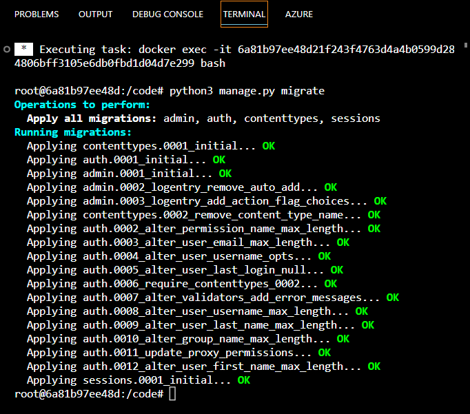

The `migrate` command is used to update the database schema over time as the application evolves - we will cover migrations in more detail this afternoon.

# Defining Routes - URLs

As you learned with Express, there needs to be a route defined that matches each HTTP request coming from the browser.

Also, we know that the purpose of a route is to map an HTTP request to code.

We also know that Django’s routing system matches the URL (path) of the request **only** and ignores the HTTP method/verb.

For the HOME page functionality, we’ll use the root route (http://localhost:3000) - let’s see how…

## One-time URL Setup

In Django, routes are defined within **URLconf** modules named `urls.py`.

There’s an existing project `catcollector/urls.py` that we could add additional routes to, but it’s a best practice for each Django app to define its own and **include** those URLs in the project’s URLconf.

> 🧠 FYI, There are some helpful comments at the top of `catcollector/urls.py`.

So, let’s start by setting up `main_app`’s own `urls.py`:

1. Create the URLconf module in the terminal:
    
```bash
touch main_app/urls.py
```
    
2. Include it in the project’s `catcollector/urls.py`

```python
from django.contrib import admin
# Add the include function to the import
from django.urls import path, include

urlpatterns = [
    path('admin/', admin.site.urls),
    # In this case '' represents the root route
    path('', include('main_app.urls')),
]
```

Be sure to import the `include` function near the top.

Each item in the `urlpatterns` list defines a URL-based route or, as in the case above, mounts the routes contained in other URLconf modules.

Note that similar to how Express appends paths defined in a router module to the path in `app.use`, the paths defined in `'main_app.urls'` will be appended to the path specified in the `include` function.

You can close `catcollector/urls.py` since all routes we define from this point forward will be defined within `main_app/urls.py`.

3. Now for the boilerplate needed in `main_app/urls.py`:

```python
from django.urls import path
from . import views

urlpatterns = [

]
```

We’ve imported the `path` function that will be used to define each route.

We’ve also created the required `urlpatterns` list that will hold each route we define for `main_app`.

## Define `main_app`’s Home Page URL & View

With the setup done, we’re ready to define the route to display the Home page.

In `main_app/urls.py`:

```python
urlpatterns = [
  path('', views.home, name='home'),
]
```

The above code defines a root path using an **empty string** and maps it to the `view.home` view function that does not exist yet - making the server unhappy.

The `name='home'` kwarg is technically optional but will come in handy for referencing the URL in other parts of the app, especially from within templates, so we will always use it.

The Home page route has been defined! On to the view…

# Defining View Functions

> ❓ **What is the equivalent to a Django View Function in Express?**

In the URL for the Home page we referenced a view function named `home`.

Let’s define it where we will define all of the app’s views, in `main_app/views.py`:

```python
from django.shortcuts import render

# Add the following import
from django.http import HttpResponse

# Define the home view
def home(request):
  return HttpResponse('<h1>Hello ᓚᘏᗢ</h1>')
```

> 💡 Note that in order to use the HttpResponse function, we must import it like the others we’ve used so far.

Just a baby step for now. What we’ve done is define a view function that responds to the browser’s HTTP request by sending a string (that resembles a cat).

All view functions need to define a positional parameter to accept a *request* object Django will be passing in. This *request* object is very much like the `req` object we worked with in Express controller actions. As shown above, the parameter is typically named `request`.

The function `HttpResponse` is the simplest way to send something back in response to a request. It’s like `res.send()` was in Express.

We will learn some more powerful ways to respond shortly when we start rendering templates.

Now when browsing to http://localhost:3000, we should see our welcoming cat instead of seeing the rocket page!

### You do (5 minutes) - Define another URL and View Function 💪

1. Define another route with a path of `about/`. Define it **exactly** as shown (with a trailing slash instead of a leading slash). This is the convention for Django. If you add a leading slash you will be presented with this warning:

tktk - Hunter this is the image from the notion content
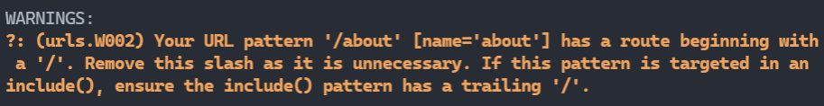
    
1. Name the route `'about'`.
2. Map the route to a view named `views.about`.
3. Define the `about` view function referenced in step 3 so that it displays the following text: `<h1>About the CatCollector</h1>`

Test it by browsing to http://localhost:3000/about:

tktk - Hunter this is the image from the notion content
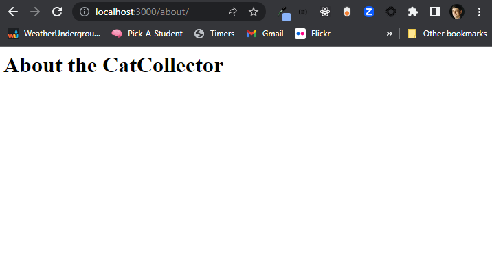

# Using Django Templates

So, we just finished responding to requests by using `HttpResponse()` to send back a string of HTML (just like we did when using Express for the first time using `res.send()`).

Now let’s move beyond the baby step by rendering a template instead.

Just like how Express can use different templating engines (Jade, EJS, etc.), so can Django.

Django has two templating engines built-in:

- Its own Django Template Language (DTL), and
- [**Jinja2**](http://jinja.pocoo.org/), a Python template engine, inspired by Django’s DTL.

Not surprisingly, a Django project is pre-configured to use DTL, which is very capable, so we’ll be using it throughout this unit.

## One-time Template Setup

By default, a Django project is configured to look for templates inside of a `templates` folder within each app’s folder (`main_app` in this case).

In the terminal let’s create that `templates` folder for `main_app` to hold all of its template files:

```bash
mkdir main_app/templates
```

### Create an `about.html` Template

Let’s start with a simple template for the About page:

1. In the terminal create the template:
    
```bash
touch main_app/templates/about.html
```
    
Note that Django templates have a simple `.html` file extension. With a proper configuration Django will identify these files as Django HTML. Ensure you have installed the [**Django extension**](https://marketplace.visualstudio.com/items?itemName=batisteo.vscode-django) in VS Code.

2. Open `about.html` and add the boilerplate (`! + tab`) and update the `<title>`:
    
```html
<!DOCTYPE html>
<html lang="en">
<head>
    <meta charset="UTF-8">
    <meta http-equiv="X-UA-Compatible" content="IE=edge">
    <meta name="viewport" content="width=device-width, initial-scale=1.0">
    <title>Cat Collector</title>
</head>
<body>
    
</body>
</html>
```
    
3. Add a bit of custom markup within the `<body>`:

```html
<h1>About the Cat Collector</h1>
```

4. Now update the `about` view in `views.py` to `render` the `about.html` template instead of sending a string response:
    
```python
# We're already importing render from django.shortcuts
from django.shortcuts import render

...

def about(request):
    return render(request, 'about.html')
```
    
The `render()` shortcut in Django is similar to Express’ `res.render()`, except for the positional `request` arg. Also, the `.html` extension is required. For more on `render()`, check out more in the docs [**here**](https://docs.djangoproject.com/en/4.0/topics/http/shortcuts/#render).

Browsing to [localhost:3000/about](http://localhost:3000/about) will now render the new `about.html` template!

So far, so good, but we haven’t yet used any of DTL’s power to dynamically render data, perform control flow, etc.

Next, before we go any further and break the DRY principle by repeating the boilerplate in future templates, let’s see how we can use what Django calls **template inheritance**.

# Template Inheritance (Partials)

Django has a **[template inheritance](https://docs.djangoproject.com/en/4.2/ref/templates/language/#template-inheritance)** feature built-in.

[Django](https://docs.djangoproject.com/en/4.2/ref/templates/language/#template-inheritance)

Template inheritance is like using partials in EJS with Express, except they’re more flexible.

The reason Django calls it template *inheritance* is because:

- You can declare that a template **extends** another template.
- Extending another template results in defined **blocks** *overriding* (replacing) blocks defined in the template being extended.

Here's an example of how this works:

`base.html`:

tktk - Hunter this is the image from the notion content
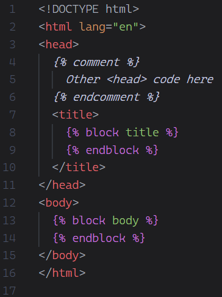

`index.html`:

tktk - Hunter this is the image from the notion content
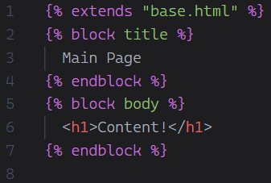

This produces the following final code that will be delivered to the client when rendering `index.html`:

tktk - Hunter this is the image from the notion content
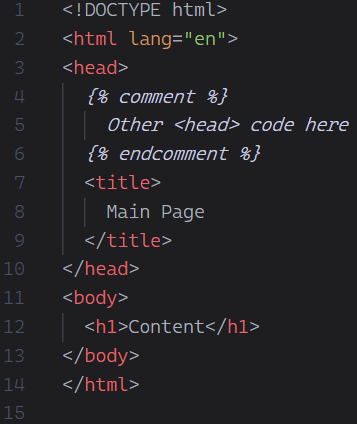


Here’s how it works in practice. Most of the job of this file will be to house our nav bar. This is the wireframe for it:

tktk - Hunter this is the image from the notion content
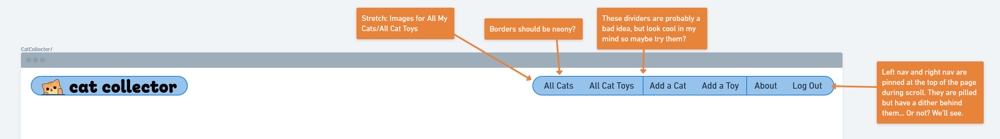

First, in the terminal, let’s create a `base.html` template (named by convention):

```bash
touch main_app/templates/base.html
```

This is the template that will hold all of the boilerplate and markup that belongs on every page, such as the `<head>`, navigation, even a footer if you wish.

This will be our boilerplate in `main_app/templates/base.html` for now:

```html
<!DOCTYPE html>
<html lang="en">
<head>
  <meta charset="UTF-8">
  <meta http-equiv="X-UA-Compatible" content="IE=edge">
  <meta name="viewport" content="width=device-width, initial-scale=1.0">
  <link
    rel="shortcut icon"
    type="image/png"
    href=""
  >
  <title>Cat Collector</title>
  
  
</head>
<body>
  <header>
    <div class="header-logo-container">
      <a href="/">
        
      </a>
    </div>
    <nav>
      <ul>
        <li><a href="/about">About</a></li>
      </ul>
    </nav>
  </header>
  <main>
    
    
  </main>
</body>
</html>
```

There’s an image here that will cause a 404 error for now. Go ahead and ignore this for now, we’ll fix it in the next section.

The most important part of the boilerplate in regards to template inheritance is:

```html


```

and

```html


```

Hey, that’s our first look at DTL **template tags**, `block` & `endblock`, enclosed within the template tag delimiters ``.

Django **[template tags](https://docs.djangoproject.com/en/4.2/ref/templates/builtins/#ref-templates-builtins-tags)** control logic within a template. Depending upon the tag, they may, or may not result in content being emitted in the page.

Whenever another template **extends** this `base.html`, that other template’s `` will replace the same block in `base.html`.

To see template inheritance in action, let’s update `about.html` so that it extends `base.html`:

```html




<h1>About the Cat Collector</h1>
<hr />
<p class="page-content">
  I like long romantic walks down the produce aisle. Also, I am currently job seeking!
</p>


```

Refresh. Yeah, it’s not great looking (yet), but the template inheritance is working and we can stay nice and DRY.

# Including Static Files in a Template

As you know, web apps usually have static files such as `.css`, `.js`, image files, etc.

If we want Cat Collector to look better, we’re going to have to be able to define some custom CSS.

Django projects are pre-configured with a `'django.contrib.staticfiles'` app installed for the purpose of serving static files.

At the bottom of `settings.py`, there is a `STATIC_URL = 'static/'` variable that declares what folder within apps to look for static files in.

We need that folder, so let’s create it in the terminal:

```bash
mkdir main_app/static
```

Next, let’s create a folder within `static` dedicated to CSS in the terminal:

```bash
mkdir main_app/static/css
```

Now let’s create a `base.css` in the terminal:

```bash
touch main_app/static/css/base.css
```

For now, just to make sure that `base.css` is properly loaded, let’s put in a touch of hideous CSS:

```css
body {
  background-color: red;
}
```

All we have to do is tweak `base.html` by first adding the `load` template tag at the top:

```html


<!DOCTYPE html>
```

tktk - Hunter this is the image from the notion content
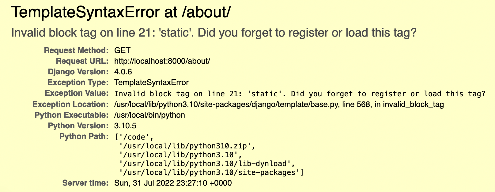

Finally, add this `<link>` before the `` line:

```html
  <link rel="stylesheet" type="text/css" href="">
```

We’re going to be using some adorable cat pictures in this app. You can get all of the images we're going to use right [**here**](https://drive.google.com/drive/folders/1hIP9SjZYAeSXoyvLieOSEcTIvWjtsIq7?usp=sharing). 

All these images need to go in a new directory we create using the terminal:

```bash
mkdir main_app/static/images
```

The end result should look like this:

tktk - Hunter this is the image from the notion content
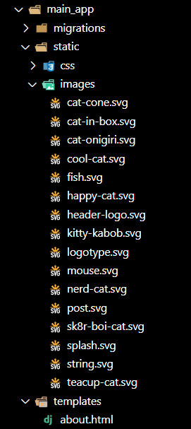

And add a valid `href` to the favicon in the `head` of our `base.html`:

```html
<link
    rel="shortcut icon"
    type="image/png"
    href=""
>
```

And also for the header logo:

```html

```

The `static` DTL template tag ensures that the correct URL is assigned to the `href`. You can read more about managing static files in the Django docs [here](https://docs.djangoproject.com/en/4.2/howto/static-files/#how-to-manage-static-files-e-g-images-javascript-css).

> Django recommends name-spacing our files within the `static` directory further, but that is overkill for this application, so we won’t be doing that here.

Refresh - and red background tells us that `base.css` is being loaded. 

Let’s update it with the following more pleasing CSS. We're going to be adding the mostly complete CSS to each one of our CSS files as we go through this app, so these CSS files may look really bulky at first and we won't use all the rules initially - don't worry though we'll use it all eventually. These files also implement mobile responsiveness as well.

> If you do not see the red background, **you may need to restart the server**. Static files are not reloaded automatically.

```css
html {
  box-sizing: border-box
}

/* The Universal Selector */
*, /* All elements*/
*::before, /* All ::before pseudo-elements */
*::after { /* All ::after pseudo-elements */
  /* height & width will now include border & padding by default
     but can be over-ridden as needed */
  box-sizing: inherit;
}

/* resets font size to be 62.5% of the user preference - 
     in most browser configurations this will be 10px */
:root {
  font-size: 62.5%
}

body {
  margin: 0;
  display: flex;
  flex-direction: column;
  align-items: center;
  font-family: -apple-system, BlinkMacSystemFont, 'Segoe UI', 'Roboto', 
    'Oxygen', 'Ubuntu', 'Cantarell', 'Fira Sans', 'Droid Sans', 
    'Helvetica Neue', sans-serif;
  min-height: 100vh;
  --nav-bg: rgba(104, 197, 248, .7);
  --nav-bg-ff: rgba(104, 197, 248, .9);
  --borders: rgb(36, 116, 248) solid 2px;
  --text-color: rgb(17, 20, 17);
  --link-hover-color: rgb(16, 56, 158);
  --button-bg: rgb(245, 245, 245);
  --button-bg-hover: rgb(226, 226, 226);
  --submit: rgb(26, 128, 0);
  --warn: rgb(255, 102, 0);
  --danger: rgb(220, 20, 30);
  --secondary: rgb(57, 57, 57);
  --card-box-shadow: 5px 5px 6px -1px #AAA;
  --font-xtreme: 4.2rem;
  --font-xxl: 3.6rem;
  --font-xl: 2.4rem;
  --font-l: 1.8rem;
  --font-reg: 1.6rem;
  --card-border-radius: 6px;
}

header {
  width: 100%;
  background: var(--nav-bg-ff); /* rgba(104, 197, 248, .9) */
  border-bottom: var(--borders);
}

nav {
  margin: 10px;
}

ul {
  margin: 0;
  list-style: none;
  padding: 0;
}

main {
  width: 100%;
  padding: 0 10px;
}

h2 {
  font-size: var(--font-xl);
}

nav a {
  text-decoration: none;
  color: var(--text-color);
  font-weight: 600;
  font-size: 16px;
}

nav a:hover {
  color: var(--link-hover-color)
}

nav ul {
  display: flex;
  align-items: center;
  justify-content: center;
  flex-wrap: wrap;
}

nav li {
  padding: 5px 8px;
}

.header-logo-container {
  margin: auto;
  padding: 10px 20px 0;
  max-width: 500px;
}

.page-header {
  display: flex;
  align-items: center;
  margin: 20px;
}

.btn {
  font-size: var(--font-l);
  padding: 8px 16px;
  border-radius: 6px;
  border-width: 2px;
  border-style: solid;
  text-decoration: none;
  background-color: var(--button-bg);
  font-weight: 600;
  cursor: pointer;
  font-family: inherit;
  margin-right: 10px;
}

.btn:hover {
  background-color: var(--button-bg-hover);
}

.submit {
  color: var(--submit);
  border-color: var(--submit);
}

.secondary {
  color: var(--secondary);
  border-color: var(--secondary);
}

.warn {
  color: var(--warn);
  border-color: var(--warn);
}

.danger {
  color: var(--danger);
  border-color: var(--danger);
}

.page-header h1 {
  font-size: var(--font-xxl);
  margin: 0;
}

.page-header img {
  height: 40px;
  margin-left:15px;
}

.page-header img:first-of-type {
  margin-left: 20px;
}

.page-content {
  font-size: var(--font-reg);
}

@media only screen and (min-width: 768px) {
  header {
    position: sticky;
    display: flex;
    flex-direction: row;
    top: 0;
    align-items: center;
  }

  main {
    max-width: 1300px;
    min-height: calc(100vh - 53px);
  }

  nav,
  .header-logo-container {
    margin: 10px 0;
    padding: 0 15px;
  }

  /* visual fix to help align logo */
  .header-logo-container {
    padding-top: 3px;
  }

  nav {
    margin-left: auto;
    display: flex;
    justify-content: center;
  }

  nav ul {
    flex-wrap: nowrap;
  }

  .header-logo-container {
    width: 213px;
  }

  .page-header h1 {
    font-size: var(--font-xtreme);
  }
  
  .page-header img {
    height: 50px;
    margin-left:20px;
  }
  
  .page-header img:first-of-type {
    margin-left: 25px;
  }

  @supports (-webkit-backdrop-filter: none) or (backdrop-filter: none) {
    header {
      background: var(--nav-bg);
      -webkit-backdrop-filter: blur(3px);
      backdrop-filter: blur(3px);
    }
  }
}

@media only screen and (min-width: 1024px) {
  main {
    min-height: calc(100vh - 55px);
  }
  
  header {
    margin: 20px 20px 0 20px;
    width: calc(100vw - 40px);
    max-width: 1920px;
    top: 20px;
    background-color: transparent;
    border-bottom: none;
  }

  nav,
  .header-logo-container {
    margin: 0;
    background: var(--nav-bg-ff);
    border: var(--borders);
    border-radius: 18px;
  }

  nav {
    margin-left: auto;
  }

  .header-logo-container {
    /* visual fix to help align logo */
    padding-top: 6px;
    width: 256px;
    height: 35px;
  }

  @supports (-webkit-backdrop-filter: none) or (backdrop-filter: none) {
    header {
      -webkit-backdrop-filter: none;
      backdrop-filter: none;
    }

    nav,
    .header-logo-container {
      background: rgba(104, 197, 248, .6);
      -webkit-backdrop-filter: blur(3px);
      backdrop-filter: blur(3px);
    }
  }
}
```

Get them in place then do refresh! That’s better!

tktk - Hunter this is the image from the notion content
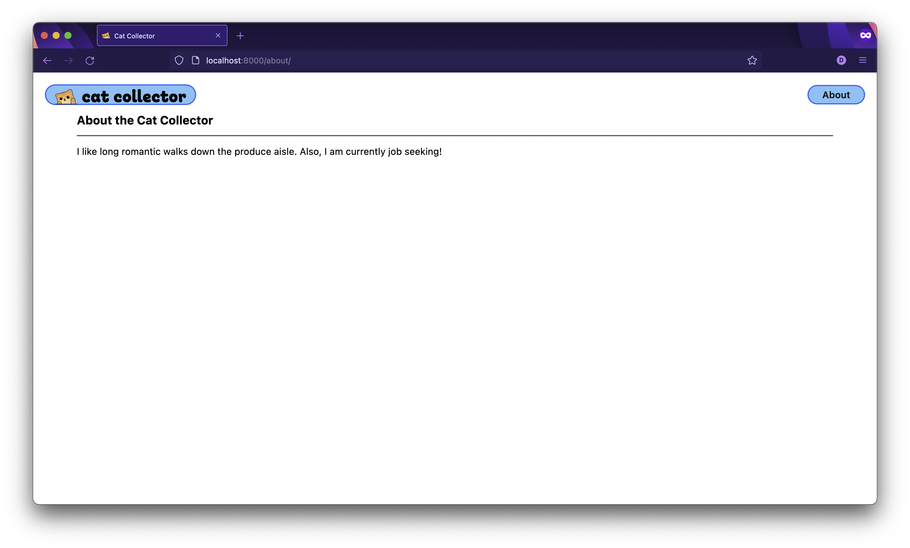

# Render Data in a Template

To see how data is rendered dynamically using Django templating, we’re going to implement the following user story:

*As a User, when I click the **All Cats** link, I want to see a page listing all of my cats so that I can see them all one one place which will make me delighted.*

Here's a wireframe to guide us as well:

tktk - Hunter this is the image from the notion content
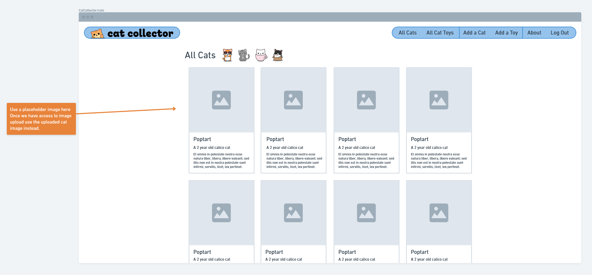

Luckily the ‣ from the Unit 2 you had tattooed applies to all web frameworks!

## Step 1 - Identify the “Proper” Route

For this **index** page user story, what would the RESTful route be? `/cats`

## Step 2 - Create the UI

For the UI, it makes sense to add the **View All My Cats** link to the navigation bar in `base.html`:

```html
<!-- new markup below -->
<li><a href="/cats">All Cats</a></li>
<!-- existing markup -->
<li><a href="/about">About</a></li>
```

**IMPORTANT: Be sure to continue to use leading slashes in the HTML!**

A quick refresh and we have our link:

tktk - Hunter this is the image from the notion content
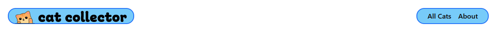

## Step 3 - Define the Route

Now let’s add the new route to `main_app/urls.py`:

```python
urlpatterns = [
  path('', views.home, name='home'),
  path('about/', views.about, name='about'),
  # route for cats index
  path('cats/', views.cat_index, name='cat-index'),
]
```

We only have a single `views.py`, so by naming the view `cat_index` we’re anticipating that there might be another *index* view for a different resource in the future (*toys* maybe?).

Of course, by referencing a nonexistent view, the server’s not happy.

## Step 4 - Code the View (Controller Action)

Let's simulate some cats...

We’re going to use a `Cat` class to simulate a Cat Model and use it to create some cats in a `cats` list. We'll do this in `main_app/views`:

```python
# Add the Cat class & list and view function below the imports
class Cat:  # Note that parens are optional if not inheriting from another class
  def __init__(self, name, breed, description, age):
    self.name = name
    self.breed = breed
    self.description = description
    self.age = age

cats = [
  Cat('Lolo', 'tabby', 'Kinda rude.', 3),
  Cat('Sachi', 'tortoiseshell', 'Looks like a turtle.', 0),
  Cat('Fancy', 'bombay', 'Happy fluff ball.', 4),
  Cat('Bonk', 'selkirk rex', 'Meows loudly.', 6)
]
```

> 🧠 Note: Everything in a Python module is automatically exported, thus, the Cat class and the cats list will be accessible in other modules.

Let’s type in the `cat_index` view inside of `views.py`:

```python
# Add new view
def cat_index(request):
  return render(request, 'cats/index.html', { 'cats': cats })
```

Two interesting things above:

1. We’re going to be name-spacing the `index.html` template by putting it in a new `templates/cats` folder for organizational purposes - just like we did in Express.
2. Similar to how we passed data to a template in Express using a JS object, we pass a dictionary as a third positional argument in Django’s `render` function.

## Step 5 - Respond to the Client’s HTTP Request

We’ve already written the code to respond using the `render` method in the view.

However, we need to create the `cats/index.html` template we want to render.

First, in the terminal, we need to create the `templates/cats` folder we’ll use to organize cat related templates:

```bash
mkdir main_app/templates/cats
```

Now in the terminal, create the `cats/index.html` template file:

```bash
touch main_app/templates/cats/index.html
```

Now the fun stuff. We’ll copy/paste this into the new file then review:

```html




<link 
  rel="stylesheet"
  type="text/css"
  href=""
/>




<section class="page-header">
  <h1>Cat List</h1>
  
  
  
  
</section>

<section class="card-container">
  
    <div class="card">
      <div class="card-content">
        <div class="card-img-container">
          
        </div>
        <h2 class="card-title">{{ cat.name }}</h2>
        
          <p>A {{ cat.age }} year old {{ cat.breed }}</p>
        
          <p>A {{ cat.breed }} kitten.</p>
        
        <p><small>{{ cat.description }}</small></p>
      </div>
    </div>
  
</section>


```

There are two control flow template tag constructs you’ll use quite a bit:

- The `` / `` block used to perform looping
- The `` / ` /  / ` block used for branching.


> Important: Django template tags are designed to mimic very closely their Python counterparts, however, they are not embedding Python the way EJS embedded JavaScript.

For example, Python does not have `endfor` or `endif` as part of the language.

Next notice how double curly brace syntax `{{}}` is used to print the values of variables and object properties.


> 🧠 Note: If the property on an object is a method, it is automatically invoked by the template engine without any arguments and we do not put parens after the method name. For example, assuming a person object has a getFullName method, it would be used like this {{ person.getFullName }} in the template. This is another example of how DTL is its own language and not Python. You can read more about DTL **[here](https://docs.djangoproject.com/en/4.2/ref/templates/language/)**.

Before you click that link though, let's add in a bit of quick styling. In the terminal create the files:

```bash
mkdir main_app/static/css/cats
touch main_app/static/css/cats/cat-index.css
```

And throw some CSS in that file:

```css
.card-container {
  padding: 0 30px;
  display: flex;
  justify-content: center;
  flex-wrap: wrap;
}

.card {
  width: 275px;
  margin: 10px;
  border: var(--borders);
  box-shadow: var(--card-box-shadow);
}

.card-content {
  padding: 10px;
  width: 100%;
}

.usr-img {
  width: 100%;
  border-radius: var(--card-border-radius);
}

.card > a {
  text-decoration: none;
  color: var(--text-color);
}

.card h2 {
  margin: 10px 0;
  font-size: var(--font-xl);
}

.card p {
  margin: 5px 0;
  font-size: var(--font-reg);
}
```

Finally, the moment you've been waiting for!

tktk - Hunter this is the image from the notion content
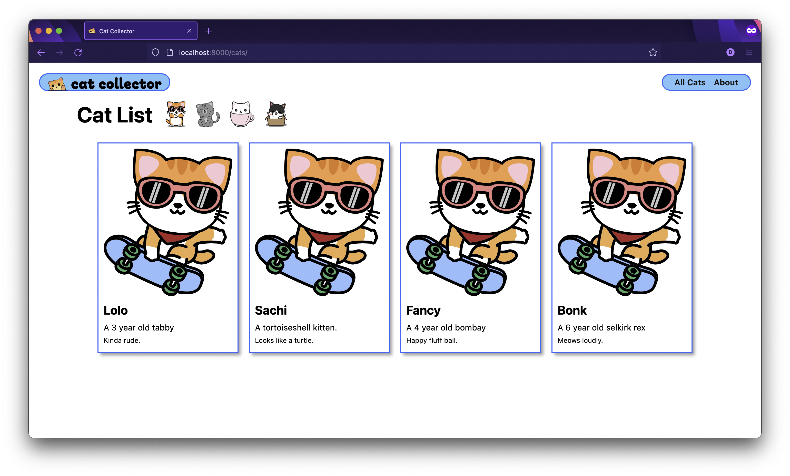

# Summary

You now have a minimal but functional application that renders an **index** page that dynamically displays a hard-coded list of Cat objects.

You now know pretty much all there is to know about URLs and the overall structure of a Django app.

However, we’ve only touched upon the basics of views and DTL templating.

We’re going to get our first look at Models in the next lesson where we’ll use one to replace the current `Cat` class so that we can save cats in the database!